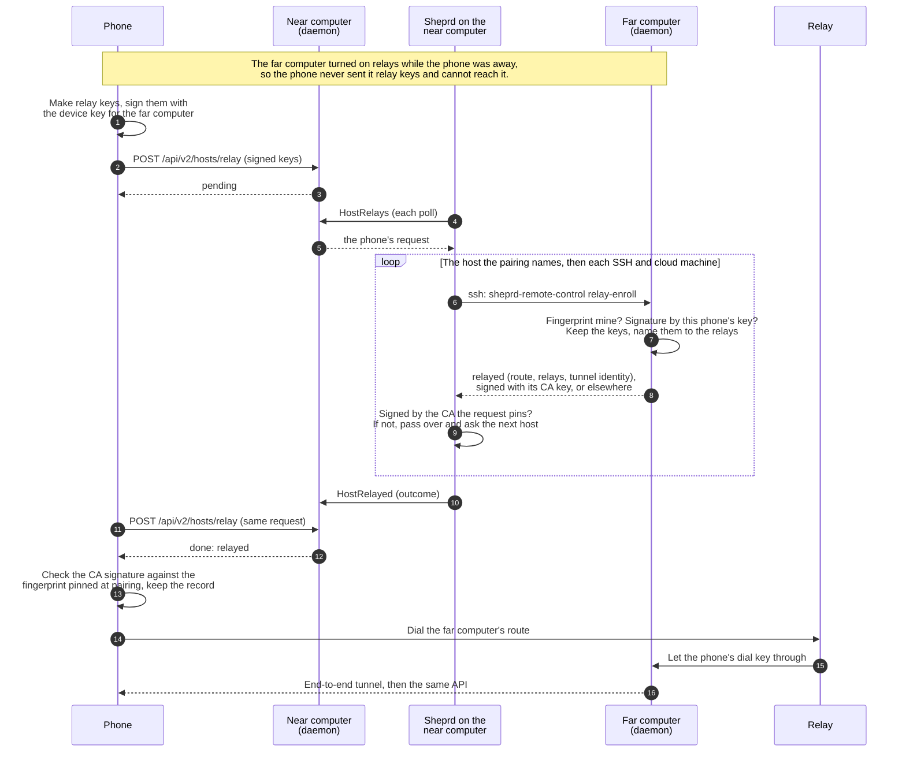
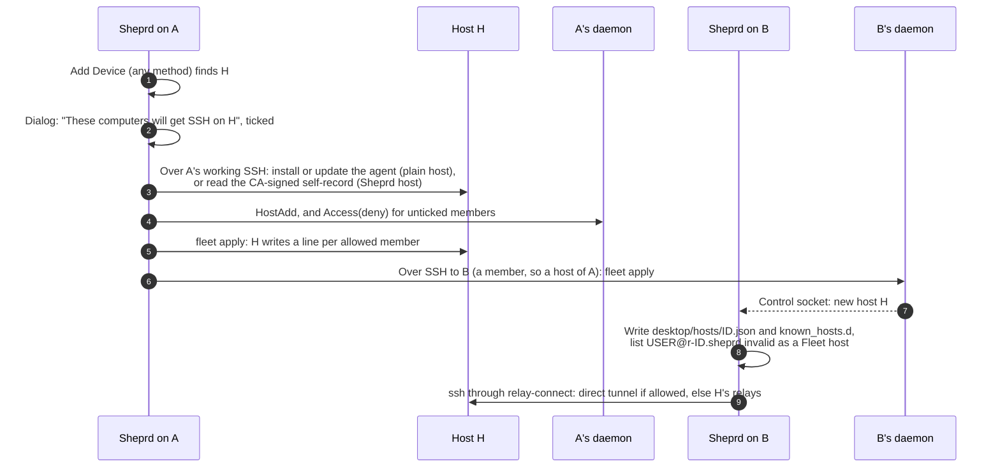

# Plan: Sheprd's own relay, replacing Tailscale

Today a phone reaches a computer's `sheprd-remote-control` daemon only on the
same network or over Tailscale, and Sheprd finds SSH machines through
`tailscale status`. Users without Tailscale lose both away from home. This
plan adds `sheprd-relay`: a small service we and anyone else can run, which
joins two Sheprd peers when they have no direct path, while seeing only
ciphertext. Read `AGENTS.md` first; its rules apply throughout.

Direct paths stay first. The relay is the fallback that makes a connection
work from any network, not a detour for traffic that has a better route.

## Decisions

| Question | Decision |
| --- | --- |
| What the relay is | A blind pipe: it joins two byte streams and counts bytes. It never holds a key that opens them. |
| Transport | QUIC on UDP 443 (quinn; `NWConnection` with QUIC on iOS): one connection per peer, a stream per session, no head-of-line blocking between sessions, and connection migration when a phone moves between Wi-Fi and cellular. A few fixed-size binary headers, then raw bytes; no protobuf or other codegen. WebSockets over HTTPS on TCP 443 stay as the fallback for networks that block UDP, so it always works. |
| Who can listen | Whoever proves a P-256 key. The route is SHA-256 of the key, so nobody can take over another computer's route. There are no accounts and nothing to authorize on the relay; an operator may set one optional token to keep a relay to their own computers. |
| Who can dial | Only devices the computer names. A computer gives the relay the public dial keys of its paired devices; any other dial hears `offline`, as if the computer were not there, and never reaches it. Revoking a device ends its sessions at once. |
| End-to-end encryption | Hybrid post-quantum Noise inside the stream (below). TLS to the relay protects only metadata. |
| State | None. Memory only; a restart drops sessions and listeners reconnect. No database, no volume. |
| Many relays | Relays share nothing and never forward to each other. A computer listens on every relay it knows; a dialer only ever dials the computer's relays, never its own, so two machines near different relays still meet. The dialer tries the relay with the shortest whole path first (Choosing the nearest relay). Adding a region is starting a droplet. |
| Choosing a relay | Sheprd's relays by default, listed in one static file, `https://sheprd.org/relays.json`, so they are added or all removed without a release; or the user's own: any number of private endpoints, which can replace ours entirely (below). |
| Zero config | Every setting has a safe default. The image runs with no settings; `deploy/relay` serves it at `IP.sslip.io` with a Let's Encrypt certificate and no DNS work. |
| Operator safety | Limits on connections (total and per address), listeners, sessions (total and per route), frame size, bandwidth (per session and total), idle and total session time, and dial and listen rates. |
| Telemetry | Prometheus at `/metrics` on its own port, and a read-only dashboard behind a login. Neither carries an address, a full route, or a byte of payload. |

### Still open

These change client work only; the relay is the same either way.

1. **Scope.** This plan covers both phone to daemon and Sheprd to SSH
   machines, phased. Phone to daemon comes first.
2. **One tunnel implementation or two.** Recommended: one Rust crate,
   `sheprd-tunnel`, used by the daemon and Sheprd, and by the iOS app through
   a small UniFFI framework, so the handshake is written and tested once.
   The other option is a Swift copy checked against shared test vectors.

## Architecture

```text
phone ──QUIC──▶ relay ◀──QUIC── computer (sheprd-remote-control, listening)
   └────── Noise IK + ML-KEM-768, end to end ──────┘

Sheprd ──QUIC──▶ relay ◀──QUIC── SSH machine (sheprd-relay-agent → 127.0.0.1:22)
   └──── Noise, then SSH's own encryption inside it ───┘

Either side may use a WebSocket over HTTPS instead, when UDP is blocked.
```

### The relay (`crates/sheprd-relay`, built)

Tokio, quinn, and axum. No GPUI, and no dependency on the client crates: it
knows streams, routes, and limits, nothing else.

#### QUIC (`wire`, `quic`)

ALPN `sheprd-relay/1`, TLS 1.3. Every stream a peer opens starts with one
request; the relay answers with one status byte. Keys are SEC1 compressed
P-256 (33 bytes), signatures `r ‖ s` (64).

| Request | Bytes |
| --- | --- |
| Listen | `0x01`, key, signature, token length (1), token (0–255) |
| Dial | `0x02`, route (32), dial key, signature |

A listener then says who may dial it, on its listen stream:

| Message | Bytes |
| --- | --- |
| Dial keys | `0x20`, count (1, at most 64), keys |
| Pairing key | `0x21`, key, lifetime in seconds (2, big-endian, at most 600) |

Statuses: `0` ok, `1` offline, `2` busy, `3` timeout, `4` limited,
`5` refused (bad proof), `6` forbidden (token), `7` full, `8` malformed,
`9` too many (pairing keys).

- **Proofs.** Listeners sign `"sheprd-relay/listen/quic/v1\0"`, dialers
  `"sheprd-relay/dial/quic/v1\0" ‖ … ‖ route`, each over 32 bytes exported
  from their own connection's TLS session (RFC 5705, label
  `EXPORTER-sheprd-relay-listen`). The export differs on every connection,
  so a proof cannot be replayed or passed through another relay, at no
  extra round trip.
- **Listening.** The listen stream stays open; closing it stops listening,
  and a newer listener for the same key resets it with code 5. Until it
  sends dial keys, no one can reach it.
- **Dialing.** Only a key the listener names, or an unexpired pairing key
  (used up by its one dial), gets through. Any other key gets `offline`,
  exactly as if no one listened. After `ok`, the stream is the session:
  raw bytes both ways. A phone holds one connection and opens a stream per
  computer it reaches.
- **Accepting.** For each dial, the relay opens a stream on the listener's
  own connection, starting with `0x10` and the dialer's key, so the
  computer knows which device calls before the end-to-end handshake. No
  new connection, no new handshake.
- **Revoking.** New dial keys replace the old set, and the relay resets
  every open session of a key left out (code 7) at once. Sessions opened
  with a pairing key are left alone, since approving a device replaces the
  keys while its pairing session is still open; they last 10 minutes at
  most.
- **Trust.** The relay makes a fresh key and self-signed certificate at
  each start, so it needs no volume and shares no file with the HTTPS
  proxy. `/v1/info`, read over ordinary HTTPS, gives the UDP port and the
  certificate's SHA-256, which clients pin; a client whose handshake fails
  reads it again. The end-to-end handshake inside the stream is what
  protects content; the pin protects the listen token and metadata.
- **Limits.** Connections count against the per-address limit before the
  handshake, so a flood costs no cryptography. 64 streams per connection;
  8 MiB stream and 32 MiB connection windows, so one session can fill a
  long, fast path; a 60-second idle timeout that clients' 15-second QUIC
  keepalives stay under.

#### WebSocket fallback and HTTP

| Route | What it does |
| --- | --- |
| `GET /v1/listen` | A computer's control socket. The relay sends `{"t":"challenge","nonce","version":1}`; the computer answers `{"key","signature","token"?}` over `"sheprd-relay/listen/v1\0" ‖ name ‖ 0x00 ‖ nonce`, where the name is the relay's host and path prefix as its endpoint gives them (`Endpoint::proof_name`, `relay.example.org/sheprd`). Binding the name stops one relay passing another's challenge through, prefixes included. The relay answers `{"t":"ready","route"}`. The computer sends `{"t":"dial_keys","keys"}` and `{"t":"pairing_key","key","seconds"}`, each answered `{"t":"status","status"}`, and hears `{"t":"incoming","session","key"}` for each dial. A newer listener with the same key replaces the older one, which is closed with 4409. |
| `GET /v1/dial/{route}` | The same challenge; the device answers `{"key","signature"}` over `"sheprd-relay/dial/v1\0" ‖ name ‖ 0x00 ‖ nonce ‖ route`, then hears `{"t":"status","status"}` with the same statuses as QUIC. After `ok`, binary frames are the session. |
| `GET /v1/accept/{session}` | The listener's socket for one dial. The session id is 128 random bits that only the listener learns, and it can be claimed once. |
| `GET /v1/info` | `{"protocol":1,"version","listen_token":bool,"quic":{"port","pin"},"websocket":bool}`, where `version` is the major and minor only (`0.1`), not an exact build, so a client can check an endpoint, know to ask for a token, and reach QUIC, before saving it. |
| `GET /healthz` | For uptime checks. |
| `/dashboard` | The read-only dashboard, when an access token is set. |

`/v1/listen`, `/v1/dial`, and `/v1/accept` refuse with 403, before anything
is counted or held, a request a browser sends for a page on another site:
`Sec-Fetch-Site` other than `same-origin` or `none`, or an `Origin` that is
not the relay's own host. Otherwise any web page could open them from its
visitors' browsers, earn their addresses bans, and hold listener slots.
Clients send neither header, or their own relay origin.

WebSocket proofs cover the relay's own name, `RELAY_PUBLIC_HOST` (set from
the domain by `deploy/relay`), which the relay checks against its
configuration, never against the request's `Host`: a client sets that
header, so a malicious relay could pass another relay's challenge to a
computer and then present the proof with its own name in `Host`. Without a
public name the fallback is off and `/v1/info` says `"websocket": false`;
QUIC, whose proofs bind the TLS session itself, needs no name.

Data is binary frames only. A text frame ends the session (4400), and a
frame over `max-frame` breaks it. A revoked key's session closes with
4403. Close codes are in `splice::code`; the messages are in `socket`.

A session may mix transports: a phone on QUIC reaches a computer that could
only open a WebSocket, and the other way round.

The relay pings idle listeners every 25 seconds, which keeps NAT mappings
open. Inside a session, keepalives are the peers' job: they are encrypted,
so the relay cannot tell a keepalive from data.

### Limits

All settings are flags or `RELAY_*` variables (`sheprd-relay --help`).

| Setting | Default | Bounds |
| --- | --- | --- |
| `max-connections` | 10,000 | Open sockets of every kind |
| `max-connections-per-ip` | 64 | Per IPv4 address or IPv6 /64 |
| `max-listeners` | 5,000 | Routes with a listener |
| `max-listeners-per-ip` | 16 | Per IPv4 address or IPv6 /64; a /24 or /48 holds 16 times this |
| `max-sessions` | 5,000 | Sessions and waiting dials |
| `max-sessions-per-ip` | 64 | Per dialing address; a /24 or /48 holds 16 times this |
| `max-sessions-per-key` | 4 | Per dial key, so a stolen key cannot take every slot of its computer |
| `max-sessions-per-route` | 32 | Per computer |
| `max-buffer` | 512 MiB | What QUIC peers may make the relay hold, across connections |
| `session-bandwidth` | 4 MiB/s | Each way, per session; 0 is unlimited |
| `total-bandwidth` | 64 MiB/s | Each way, across sessions; 0 is unlimited |
| `max-frame` | 64 KiB | Largest frame |
| `idle-timeout` | 5 min | Silent session |
| `max-session-duration` | 24 h | Any session |
| `accept-timeout` | 10 s | Listener's time to accept |
| `dials-per-minute` | 120 | Per address, a quarter of it at once |
| `listens-per-minute` | 30 | Per address |
| `connections-per-minute` | 60 | New QUIC connections per address |

One caller must not be able to fill a pool every caller shares:

- Every per-address limit and rate also applies to the address's wide
  block, an IPv6 /48 or IPv4 /24, at 16 times the address's share: a
  routed block's 65,536 /64s are not 65,536 fresh callers. A rate limiter
  whose table is full refuses newcomers without counting it against them.
- A listener may send 60 messages about who may dial it a minute, 16 at
  once. A change of dial keys looks only at that route's sessions, and one
  that changes nothing does nothing.
- QUIC windows are promises of memory: a peer may send up to its window
  that the relay has not read, which it stops doing while the far side of
  a session does not read. A connection starts with 64 KiB each way and
  gains 2 MiB each way per session it carries (2 MiB passes a session's
  4 MiB/s over a 500 ms round trip), all drawn from `max-buffer`. One
  public address may hold a quarter of it and its wide block half. When
  that is spent, new connections and sessions are refused, never buffered.
- The HTTP listener holds at most `max-connections` plus 1,024 connections,
  and, when callers connect directly, `max-connections-per-ip` plus 16 per
  public address and 16 times that per wide block. Behind a proxy every
  connection is the proxy's, so only the total applies there and the hub
  limits callers by the address the proxy reports. A connection's first
  request must arrive whole within 30 seconds of accepting it, however
  slowly it trickles in, and it is closed after the idle timeout plus a
  minute with nothing crossing it either way.
- A rate limit spends from an address's bucket and its block's only when
  both allow it, so a caller refused by its block adds nothing to the
  address table, and one held back does not drain its neighbours' share.
- Rate limits count on a monotonic clock, so a wall clock stepping back
  does not freeze refills.
- A QUIC connection that migrates keeps the address it was admitted from
  for its open sessions' budgets and bans; each new stream, and each ban
  notice, checks its current address. Migration needs the peer to prove
  it receives at the new address, and keeps phones connected across
  networks, so it stays on.

Throttles are token buckets that let one second of traffic through at once
and then charge time, so interactive sessions stay snappy while a bulk
transfer is held to its rate. Each direction has its own bucket, so a
throttled download never stalls typing.

### Banning toxic clients (`guard`)

On by default, with nothing to set up. Each address (an IPv4 address, or
an IPv6 /64) earns points for misbehaving, fading one a minute; 10 points
ban it:

| Offense | Points |
| --- | --- |
| Hitting a rate limit or the per-address connection cap | 1 |
| Probing: a route or session id that does not parse, a stream held open with no request | 2 |
| A forged proof or wrong listen token; malformed messages or frames | 3 |
| Sending more than four times `max-transfer-per-hour` (20 GiB) in an hour | 10, a ban at once |

A refused dial costs nothing, whether no one listens or the key is not
named: the two must cost the same, so a ban never reveals an occupied
route, and a phone retrying while its computer is off must never get its
household banned. The dial rate limit holds a flood of either back. Wrong
dashboard tokens block that address from the dashboard for 15 minutes,
never from the relay, so one person's typos cannot cost everyone behind a
shared address their computers.

Each side of a session is charged only for what it sends. An address over
`max-transfer-per-hour` has its sessions slowed to 256 KiB/s each way until
the hour's window ends (`sheprd_relay_throttled_seconds_total{limit="budget"}`);
only one sending four budgets anyway is banned. One session at the 4 MiB/s
limit both ways for an hour sends 14 GiB a side and is never slowed.

- Bans last 10 minutes, then an hour, then a day for repeat offenders, and
  a clean day after the last one starts over.
- A banned address is refused before any new work: before the QUIC
  handshake (even before a retry), before every new stream, and before
  every HTTP route but `/healthz`.
- A ban that any probe, forged proof, malformed message, or overrun budget
  led to also ends the address's open sessions (QUIC code 8, WebSocket
  4429), its QUIC connections, and its listeners. A ban earned by hitting
  limits alone leaves them open, and its listeners keep taking dials
  (WebSocket accepts included): a household or a carrier's NAT can hit
  limits together without anyone misbehaving.
- Bans are checked under the same lock that opens sessions and registers
  listeners, so a ban cannot slip between a dial and its session. A ban
  closes the address's QUIC connections, and every new stream checks.
- The table of addresses is bounded. When full, the unbanned record with
  the fewest points makes room; active bans are never dropped. If every
  slot is a ban, newcomers are counted by their wider block (IPv6 /48,
  IPv4 /24) in a second bounded table: points add up and ban the block as
  they would an address, and the block's transfer budget is 16 times an
  address's. Filling the table buys an attacker nothing, and one point or
  one ordinary transfer never bans a neighbour's block.
- Loopback and private addresses are never banned automatically: behind a
  reverse proxy that is misconfigured, every caller can look like the
  proxy, and banning it would lock everyone out.
- By hand: `RELAY_BAN=203.0.113.0/24,2001:db8::/32`, or `--ban-file FILE`,
  one range per line, re-read every 30 seconds. A manual ban applies to any
  address, private ones included, and ends what it covers at once.
- `RELAY_AUTO_BAN=off` turns automatic bans off. The dashboard lists active
  bans with their reason and time left; `/metrics` has
  `sheprd_relay_strikes_total{offense}`, `sheprd_relay_bans_total{offense}`,
  and `sheprd_relay_banned`. Logs say a ban happened and why, never the
  address.

### Telemetry

`/metrics` listens on its own port (default `127.0.0.1:9090`; `off` turns it
off), optionally behind `RELAY_METRICS_TOKEN`. Series:

- `sheprd_relay_connections{kind}`, `sheprd_relay_listeners`,
  `sheprd_relay_sessions`, `sheprd_relay_pending_dials` (gauges)
- `sheprd_relay_bytes_total{direction}`, `sheprd_relay_frames_total{direction}`
- `sheprd_relay_dials_total{outcome}`, `sheprd_relay_listens_total{outcome}`
- `sheprd_relay_refused_connections_total{limit}`
- `sheprd_relay_sessions_ended_total{reason}`,
  `sheprd_relay_session_duration_seconds` (histogram)
- `sheprd_relay_throttled_seconds_total{limit}`
- `sheprd_relay_dashboard_logins_total{outcome}`
- `sheprd_relay_build_info{version}`, `sheprd_relay_start_time_seconds`

`sheprd_relay_dials_total{outcome="unauthorized"}` counts dials with a key
the computer did not name; peers were told `offline`.

The dashboard (`/dashboard`) is on only when `RELAY_DASHBOARD_TOKEN` (or
`--dashboard-token-file`) is set, at least 24 characters; `deploy/relay`
generates 32 random bytes. It shows sessions, listeners, connections,
throughput over ten minutes, bytes carried, refusals, dial and listen
outcomes, and the busiest sessions by the first eight characters of their
route, live: `GET /dashboard/api/live` streams a snapshot a second as
Server-Sent Events. It changes nothing.

- Logins posted from another site (by `Sec-Fetch-Site`, or `Origin`
  against the relay's host) are refused before anything is counted, so a
  hostile page cannot lock its visitors out.
- One access token, compared in constant time. Three wrong tries from an
  address (an IPv4 address or IPv6 /64) block it from the dashboard for
  15 minutes, never from the relay; while blocked, its tries are refused
  unchecked, before the limit below, so they cannot use it up. Logins
  across all addresses are also limited to 60 a minute, against guessing
  from many addresses.
- A live stream ends when its login expires; 16 may be open at once.
- The session cookie is 32 random bytes the relay keeps a record of (their
  SHA-256 and expiry, 32 sessions at most, the oldest dropped first). It
  lasts 12 hours, and is `HttpOnly; Secure; SameSite=Strict;
  Path=/dashboard`. Signing out forgets it on the relay, so a copied cookie
  stops working then; a restart signs everyone out.
- Banned addresses are shown masked (`203.0.113.x`, `2001:db8:7:x` for a
  /64), enough to tell bans apart and ban a range by hand, so a leaked
  dashboard names no household. Wide blocks and manual ranges show as
  they are.
- `/metrics`, when it has a token, blocks a caller for 15 minutes after
  three wrong ones, as the dashboard does.
- The page has a strict CSP (no inline script or style), `frame-ancestors
  'none'`, and `no-store`. All values go in through `textContent`.

### Logs

One line at start (addresses, limits, whether the dashboard is on) and one
per failed dashboard login. No addresses, routes, sessions, or payloads.

Routes and session ids are in URL paths (`/v1/dial/{route}`,
`/v1/accept/{session}`), so whatever sits in front could log them.
`deploy/relay`'s Caddy keeps no access log; a platform in front, such as
App Platform, may. A route is a pseudonym that clients make per relay (see
What clients must hold to), and a session id is good for one accept within
seconds.

**Abuse.** The relay keeps no logs to answer a complaint with, by design.
An operator answers one with bans by hand (`RELAY_BAN`, the ban file),
`total-bandwidth`, and, for a relay kept to its owner's computers, listen
tokens. Two ends the same person controls can use any open relay as a
pipe; the limits bound what that costs the operator, not whether it can
happen.

## Choosing a relay

Anyone can run a private relay (`deploy/relay`) and point Sheprd at it.
The endpoint is the only thing a user has to type, and only on the
computer: phones learn it from pairing.

**Endpoints.** `sheprd_relay::Endpoint` parses what a user types and builds
every relay URL from it (built; clients use the crate without its `server`
feature, so they get no Tokio or axum).

- `relay.example.org`, `relay.example.org:8443`, `https://…`, and `wss://…`
  are all accepted and stored as `https://HOST[:PORT][/PREFIX]`. A path
  prefix serves a relay behind a proxy that strips it.
- Plain `http://` or `ws://` is refused except for loopback, private and
  link-local addresses, and `.local` names. Content is end-to-end encrypted
  either way, but plain HTTP would expose the listen token and metadata.
- User names, passwords, queries, and fragments are refused, so a token can
  never end up in a URL, a log, or a QR code.

**The computer's setting** (`[remote]`, with Settings > Remote control >
Relays and `sheprd remote relays` beside it):

```toml
[remote]
relays = "default"   # Sheprd's relays (the default). Or one of:
# relays = "off"                                     # LAN and Tailscale only
# relays = ["https://relay.example.org"]             # only these; ours are never contacted
# relays = ["default", "https://relay.example.org"]  # both
```

- A list replaces the defaults unless it names `"default"`, so someone
  running a private relay never touches ours, not even to look one up.
- `"default"` means the relays listed at `https://sheprd.org/relays.json`
  (`sheprd_relay::directory`, built), never a list compiled into the app:

  ```json
  { "version": 1, "relays": [
    { "endpoint": "https://fra1.relay.sheprd.org", "region": "fra1", "name": "Frankfurt",
      "quic_pin": "base64url SHA-256 of its QUIC certificate" }
  ], "serial": 1794506367, "expires": 1826042367 }
  ```

  Adding or removing a relay is `just relays-add ENDPOINT REGION NAME` or
  `just relays-remove ENDPOINT`, then committing `website/site/relays.json`
  and `relays.json.asc` and letting the site deploy; clients pick it up
  within the hour. `just relays-sign` re-signs the list as it is, before it
  expires. The URL is compiled in, the parser strict (64 KiB, 64 relays,
  `https` on public hosts only, duplicates dropped, unknown fields
  ignored).
- A relay listed with its `quic_pin` keeps its QUIC certificate across
  restarts (`RELAY_QUIC_IDENTITY_DIR`; `deploy/relay` keeps it in
  `/opt/sheprd-relay/quic`). Clients pin that signed value rather than the
  one `/v1/info` reports over ordinary HTTPS, which a TLS-inspecting proxy
  or a mis-issued certificate could forge. `just relays-add` reads the pin
  from `/v1/info` and prints it, to compare with the `pin=` the relay logs
  at start before signing.
- The list is signed (`sheprd_relay::directory::signed`, behind the
  `signed-directory` feature), so changing sheprd.org, its host, or its
  DNS cannot redirect clients. Whoever controls the list would
  otherwise learn every computer's address, route, dial keys, and online
  times, could cut everyone off, and could aim every daemon at a host of
  their choosing. Clients accept the list when either of two compiled-in
  signers signed it, and Settings and `sheprd remote status` say which:
  - **Fabien Penso's OpenPGP key**, `gpg@pen.so`, fingerprint
    `3103 20A8 CC1C 5BA8 6AD0 9040 C045 1BAD F764 9BBF`, published on
    pen.so so anyone can check it, compiled in from
    `crates/sheprd-relay/keys/maintainer.asc`. The signing subkey lives on
    a YubiKey; `relays.json.asc` is its detached armored signature, made by
    `just relays-sign`. Clients check the subkey's binding, its backward
    signature, its signing flag, and its expiry. "Validated by Fabien Penso
    (OpenPGP …F764 9BBF)".
  - **The site workflow's Ed25519 key**, `RELAYS_SIGNING_KEY`, a secret of
    the `relays` environment (allowed on `main` only), received only by the
    `sign-relays` job of `site.yml`, which checks it against
    `crates/sheprd-relay/keys/actions.ed25519.hex` and publishes
    `relays.json.sig`, its raw 64-byte signature over the exact bytes
    deployed. "Validated by GitHub Actions (sheprd-labs/sheprd)". Whoever
    can change that workflow on `main` can have a list signed this way;
    required reviewers on the environment narrow that to approved runs.
  - The signed list carries a `serial` and an `expires` time: a client
    refuses a list older than the one it keeps, or expired, so an old
    signed list cannot be replayed. A list neither signer signed is
    ignored and the last good one kept.
  - Endpoints that name loopback, private, link-local, CGNAT, or `.local`
    hosts, or an IP-in-a-name service pointing at one, are refused.
  - The OpenPGP signing subkey expires on 2030-12-25: extend it, and ship
    the refreshed public key, before then.
- The daemon fetches the list at start and every hour, and keeps the last
  good one in its state directory, so a sheprd.org outage changes nothing.
  It listens on every relay listed and stops on any removed. Settings and
  `sheprd remote status` say which case holds:
  - **The list is empty:** "No Sheprd relays are available for now." The
    computer stays reachable on its LAN and private relays; phones keep
    trying direct addresses.
  - **The list could not be loaded, and none was saved:** "Could not load
    Sheprd's relay list", with the reason, and it retries.
- Each endpoint may have a listen token. Tokens are secrets, so they are not
  in the config: the daemon keeps them in `STATE_DIR/relay/tokens.json`
  (0600), keyed by endpoint, set through Settings or
  `sheprd remote relays token ENDPOINT` (read from stdin).
- Adding an endpoint calls `/v1/info` first. Settings refuses a relay that
  does not answer or speaks another protocol version, and asks for the
  token when `listen_token` is true. A relay that later goes away shows as
  unreachable in Settings and `sheprd remote status`; the others keep
  working.
- Changing the list restarts only the listen sockets, not the daemon.
- An endpoint may be a table that also labels it, so lists tell relays
  apart (`sheprd_remote_control::relay_label`, built):

  ```toml
  relays = [
    "https://relay.example.org",
    { endpoint = "https://fra3.example.org", name = "fra3",
      description = "not for public use", tags = ["eu", "private"] },
  ]
  ```

  The label is the user's own words and never reaches a relay, nor the
  machines Sheprd shares its relays with, which get the addresses only. Sheprd
  passes it to the daemon as `--relay-name`, `--relay-description`, and
  `--relay-tag` after that `--relay`; `sheprd remote status` shows it, and
  paired phones receive it in `GET /api/relay` as `labels`, keyed by
  endpoint, and list it on the computer's page. The nearby offer leaves it
  out, keeping the sealed Bluetooth payload as the vectors fix it. Names
  are at most 64 characters, descriptions 256, and tags 32, with at most 8
  tags, none blank or with a control character; a misspelt key is an
  error rather than a dropped label.

**The phone.** Pairing (QR, Nearby, Bonjour) carries the computer's
endpoints, and every connection refreshes them, so editing the list on the
computer reaches each phone the next time it connects by any path. Dialers
never need a token. Settings > Computers > a computer lists its relays, and
"Add relay" lets a user type an endpoint for a computer paired before it
had one.

**Built: the machines Sheprd connects to.** A relay added once on the
computer reaches every SSH and cloud machine its Sheprd connects to, so a
phone paired with them through it (`docs/remote-control-plan.md`, Other
machines) reaches them through the same relays:

- Sheprd (`relay_sharing`) runs `sheprd-remote-control relays --offer`
  over SSH on each connected machine that has the program, with
  `{"source", "relays"}`: this computer's host name and its `[remote]
  relays`, whole. It offers at once when the list changes or a machine
  connects, every 10 minutes after, and 2 minutes after a machine did not
  take it. An empty list is offered once per run, so a relay removed while
  Sheprd was closed is withdrawn too.
- The machine's daemon keeps each source's list in
  `STATE_DIR/relay/shared.json` (0600; 16 sources, 16 relays each), the
  offer replacing what that source shared before, and listens on its own
  `[remote] relays` and every shared relay, each once. Relays start and
  stop at once, without a restart, and its own setting is never changed.
  When the command cannot reach the daemon, it writes the file itself,
  then asks once more. The file is what stands: the daemon builds each
  change on it, reads it again once its control socket answers, and every
  minute after, so an offer written while it started, or while its socket
  was busy, is never lost.
- Every daemon certifies loopback, and keeps its relay keys even with no
  relay set, so a relay shared later serves phones at once.
- The phone learns the new relays from `GET /api/relay` the next time it
  reaches the machine directly, and checks again every 10 minutes while
  connected. Settings > Computers marks a computer it can reach through a
  relay ("Tailscale · Relay"), and its page lists the relays and says when
  the phone is connected through one.

**Sheprd to SSH machines.** `sheprd-relay-agent --relay ENDPOINT
[--token-file FILE]`, repeatable. Enrolling a device from Sheprd sets the
agent's relays to this computer's, and the device's record keeps them
(Clients, Sheprd and SSH machines).

**What is not built yet.** The `[remote] relays` setting, the token store,
Settings, the command, and the phone's side arrive with the daemon and iOS
work (phase 3). Until then no client reads a relay endpoint, so none of
these is exposed as if it worked.

### Choosing the nearest relay

With relays in several regions (say Asia, Europe, US east and west), a
session's path is phone → relay → computer, and its latency is both legs.
A relay near either end is close to the direct path, so the one to avoid
is a relay far from both.

- **The computer measures its leg.** Each listener reads its QUIC
  connection's smoothed round trip when it starts listening and every
  30 s (`Listener::rtt`), and forgets it when the relay drops it.
  `GET /api/relay`, and the nearby offer, list the relays nearest first
  and add `rtt_ms`, each listening relay's round trip in milliseconds;
  a relay the computer is not listening on now has no entry and comes
  last. Older phones ignore the field.
- **The phone measures its own leg** in the background
  (`RelayProbes`): two `GET /v1/info` per relay, timing the second so TLS
  setup is not counted, kept 5 minutes and forgotten when the network
  changes. Opening a session never waits for a probe; the first one after
  launch uses the computer's order alone.
- **The phone ranks the computer's relays** (`RelayNearness.ranked`) by
  the sum of both legs: relays the computer listens on before those it
  does not, relays the phone reached before those it could not, then the
  shortest path, ties in the computer's order. It tries them in that
  order, as before.
- The phone saves a computer's new order when it next answers directly,
  keeping its keys, and only when the order changed or a round trip moved
  by more than 20 ms and a quarter, so jitter does not rewrite the
  Keychain.

**Why relays do not forward to each other.** A mesh would let each side
use the relay nearest to itself, with the relays carrying the session
between them. It would buy little: over the public internet, phone →
nearby relay → far relay → computer is no shorter than phone → the far
relay → computer, and it doubles the relays' bandwidth. It would cost
the design's simplest properties: relays would have to trust and
authenticate each other, share every listener's dial keys or route
lookups, and keep state about where each computer is; and a private relay
could not take part without joining Sheprd's mesh. Listening on each
relay costs a computer one idle QUIC connection per region, which is
cheap for the handful of regions planned. If the list grows large, a
computer can listen on only its nearest few, since phones already try
every relay the computer names and an `offline` answer is immediate.


One relay serves many people's computers and phones. It keeps them apart
without accounts, so a public relay holds nothing worth stealing, and
each layer stands on its own:

| Layer | What stops another user |
| --- | --- |
| Routes | A route is the SHA-256 of the computer's relay key. Only that key's holder can listen on it; a second listener must prove the same key, and then replaces the first. |
| Dial keys | A computer names the public keys allowed to dial it (one per paired device, per relay, at most 64). Anyone else hears `offline`, the same answer as an empty route, so a stranger who learns a route cannot even tell whether its computer is up, and cannot spend its session slots. |
| End-to-end | Inside the stream, the Noise handshake proves both devices' static keys, pinned at pairing. Even a dial key stolen from a phone does not get past the computer without that phone's end-to-end key. |
| Limits | Per address, per route (32 sessions), and per session (bandwidth), so one user's traffic cannot starve another's. |

A device uses a different dial key on each relay, so relays run by
different people cannot match up the same phone. What a relay does learn:
addresses, timing, sizes, and which pseudonymous keys reach which route.

**Nothing to authorize on the relay.** The relay has no users, accounts,
or lists to keep. Who may reach a computer is the computer's own choice,
made when a device pairs, and the relay holds that choice only while the
computer is connected. Optional listen tokens (off by default in the
relay, on by default in the droplets `deploy/relay` makes) keep a relay to
its owner's computers; dialers never need one. A token file
(`--listen-token-file`) holds one per person or machine, `NAME: TOKEN` per
line, re-read every 30 seconds: taking a token out closes the listeners it
admitted and no one else's, and emptying or deleting the file closes them
all. `RELAY_LISTEN_TOKEN` holds a single one.

### Keys drop themselves

Nothing the relay knows outlives the connection it came on, and nothing
is written to disk, so no one ever has to clean up:

| State | Dropped when |
| --- | --- |
| A computer's route and dial keys | Its connection ends, or goes silent for 60 seconds (QUIC's idle timeout; the WebSocket fallback's missed pings). On reconnecting it names its keys again. |
| A pairing key | Its one dial, or its lifetime (the QR's two minutes), whichever comes first. |
| A device's dial key | The computer stops naming it: when the device is revoked, and on its own when the device has not connected for `device_idle_days` (30 by default, `docs/remote-control-plan.md`). Its open sessions end at once. |
| Sessions | Either side leaving, 5 minutes idle, or 24 hours. |
| Rate limits | They refill, and restart empty. |
| Everything | A restart. Computers reconnect and name their keys again within seconds. |

## Pairing a new device

Pairing works the same in the room or from far away: the QR is scanned
from the computer's screen, and everything else goes through the relay
when there is no direct path. The relay can carry pairing but cannot pair
anyone: it never sees the QR.

### What the QR holds

The existing remote control QR (`docs/remote-control-plan.md`, Pairing)
keeps its direct addresses and CA fingerprint, and gains, in its `#`
fragment so no server logs it:

| Field | Size | Why |
| --- | --- | --- |
| Pairing secret `S` | 32 bytes | Everything else is derived from it; valid 2 minutes, single use |
| Route | 32 bytes | Where the computer listens |
| Relays | 1–3 endpoints | Where to dial |
| Computer static key | 32 bytes (X25519) | Who the phone is talking to |
| Bundle fingerprint | 32 bytes | SHA-256 of the computer's full identity: X25519 key, ML-KEM-768 key, CA |

The ML-KEM key (1,184 bytes) would make the QR too dense to scan off a
screen, so the QR carries its fingerprint and the key arrives inside the
pairing channel.

Not built for the QR yet. The pairing link a desktop copies (Adding a
Sheprd from a link) carries these fields and the full identity, as it is
pasted rather than scanned.

### Steps

1. **The computer** makes `S` and derives a **pairing dial key** from it
   (`HKDF(S, "sheprd pairing dial key")` as a P-256 scalar). It registers
   that key on each of its relays as a pairing key, valid for the QR's two
   minutes and one dial.
2. **The phone** scans the QR, derives the same pairing dial key, and dials
   the route. The relay lets that one dial through and spends the key. A
   photo of the QR taken later is useless: the key is gone, and expired.
3. **The pairing handshake** runs inside the stream: Noise `IKpsk2` with
   the computer's static key from the QR and a PSK derived from `S`. Only
   someone who saw the QR can complete it, and because the PSK is
   symmetric, a recording of it stays closed even to a future quantum
   computer.
4. **The phone sends its claim**: its device key (Secure Enclave P-256, as
   today), its own X25519 and ML-KEM-768 keys, a dial key for each relay,
   and its name. The computer sends its full identity bundle, and the phone
   checks it against the fingerprint in the QR.
5. **A person approves on both screens**, as today: both show the same
   6-digit code, derived from the handshake transcript, and Sheprd asks
   "*iPhone* wants remote control of your chats. Code 428 913. Allow / Deny".
   Nothing is granted before Allow. Deny or two minutes without an answer
   closes the session.
6. **On Allow**, the computer stores the device and adds the phone's dial
   keys to its listeners on each relay. The pairing session then closes;
   from now on the phone dials with its own key and runs the normal
   hybrid handshake (Noise IK with ML-KEM-768, under End-to-end
   encryption).
7. **Other machines.** When the computer also pairs the phone with its SSH
   and cloud machines (`docs/remote-control-plan.md`, Computers), it sends
   each one the phone's keys over its existing SSH connection, and each
   adds the phone's dial key to its own listeners.

Nearby (Bluetooth) and same-network (Bonjour) pairing keep their own
commitment-based codes; after approval they hand over the same relay
data inside their channel, so a phone paired in the room also works away
from it.

**Built: Bluetooth pairing from another network.** When the computer
listens on relays, the offer it seals to a nearby phone (under the code
both screens show) also names its relays, route, and tunnel identity,
and the offer's token doubles as the pairing secret: the daemon opens a
one-dial pairing key on each relay, derived from it
(`route::pairing_dial_key`, two minutes). The phone claims at the
computer's addresses as before; when none answers, it dials that key
through a relay, runs the tunnel's pairing handshake (PSK from the
token), and claims over the same TLS inside. Every claim from a nearby
phone carries its own dial and tunnel keys, stored with the device on
Allow and named on the relays at once, so later polls, and everything
after, go through the relays with the phone's own keys. A phone paired
over Bluetooth on another network therefore works without ever sharing
a network with the computer.

### Revoking and losing a phone

- **Revoking a device** in Sheprd removes its dial keys from every relay
  the computer listens on; a device idle past `device_idle_days` is dropped
  the same way, with no one asking. The relay ends its open sessions at once, and
  its next dial hears `offline`. The computer also forgets its end-to-end
  keys, so a relay that ignored the change would still get nowhere.
- **A lost phone** is revoked the same way, from the computer or from
  another paired device.
- **A leaked relay key** (the computer's) lets someone listen on its route,
  but no paired device would complete the end-to-end handshake with them.
  Sheprd can rotate it: new key, new route, sent to each paired device the
  next time it connects by any path.

## End-to-end encryption

The relay never sees plaintext, and a relay that is taken over can drop or
delay traffic but cannot read it, change it, or pose as either side.

**Handshake: Noise `IKpsk2`, hybrid with ML-KEM-768.**

- `Noise_IKpsk2_25519_ChaChaPoly_SHA256`. IK fits: the dialer already knows
  the computer's static key from pairing, so the first message is encrypted
  and the computer learns who is calling in one round trip.
- The dialer encapsulates to the computer's static **ML-KEM-768** key, also
  learned at pairing, and sends the ciphertext in the first message's
  payload. The shared secret is the Noise PSK, mixed in at the end of the
  second message. The session is secure if either X25519 or ML-KEM-768
  holds, the pattern Rosenpass uses to protect WireGuard and the reason
  "harvest now, decrypt later" recordings stay closed.
- The prologue binds the protocol version, the relay route, and both
  parties' fingerprints, so a stream cannot be replayed onto another route.
- Static keys are pinned at pairing, beside the existing CA fingerprint. A
  computer accepts only paired devices' keys, and the phone accepts only the
  key it paired with. An unknown key is closed after the first message,
  before any application byte.
- After the handshake: ChaCha20-Poly1305 with 64-bit counters, a rekey every
  2^20 messages or ten minutes, and records padded to buckets of 256 bytes so
  keystrokes are harder to tell apart from sizes.
- Implementations: `snow` for Noise, RustCrypto `ml-kem` for the KEM, both
  maintained and audited. On iOS 26, CryptoKit has X25519, ChaChaPoly, and
  `MLKEM768` (see the open question on one implementation).

**What it protects against.** A relay or network attacker sees addresses,
timing, and padded sizes. It cannot read prompts, output, tokens, or file
names, cannot inject or reorder records, and cannot complete a handshake
with either side.

**Nothing crosses a relay before this ships.** The relay cannot enforce
encryption: the "blind pipe" claim rests entirely on this layer. Until the
Noise tunnel is built and reviewed, no client sends anything through a
relay, and when client code lands, the only way to get a relay stream is
through a completed Noise handshake.

### What clients must hold to

The relay's word is not authorization. These are requirements on clients,
since the relay cannot check them:

- **Authorize on the Noise identity, never the relay's header.** The dialer
  key in a listener's `incoming` message is what the relay says. A
  computer accepts a session only when the dialer's Noise static key is a
  paired device's, whatever key the relay named.
- **Trust a relay's QUIC pin from the signed list**, not `/v1/info`, for
  Sheprd's relays. `/v1/info` comes over ordinary HTTPS, which a
  TLS-inspecting proxy or a mis-issued certificate could forge. A private
  relay's pin is read from `/v1/info` once and kept; a change asks the
  user.
- **Refuse private addresses for public relays.** `Directory::parse`
  refuses non-public hosts in the list, but cannot see where a public
  name resolves: a client checks the resolved address before connecting
  to one of Sheprd's relays.
- **Send the listen token only over TLS.** `Endpoint` allows plain
  `http://` for this computer, a private address, or `.local`, but a
  client sends a listen token over it only to loopback: whoever answers
  mDNS for a `.local` name would otherwise read it.
- **Use a different relay key, and so a different route, per relay**,
  derived from the computer's key and the relay's endpoint, so one route
  does not link a computer across relays.
- **A stolen relay key** lets its holder contend with the computer for its
  route, until the computer rotates the key; **a stolen dial key** holds at
  most `max-sessions-per-key` sessions (4) until it is revoked. Neither
  reaches the computer past the Noise handshake.
- **Pairing:** a QR photographed in its two minutes lets someone raise an
  approval prompt with a device name of their choosing. The prompt marks
  the device as new and unverified, and approval requires comparing the
  code shown on both screens.

### What a TLS terminator sees

Whoever terminates the relay's TLS (the proxy in front, a platform, a
TLS-inspecting middlebox, or the relay itself) sees addresses, timing,
sizes, routes, and which key reaches which route, and can deny service. It
can also take over an authenticated WebSocket listen socket, since a
WebSocket proof cannot be bound to a TLS channel the relay does not end,
and name its own dial key. That reaches the computer's Noise handshake and
no further, so listener messages are not signed: signing them would add a
protocol step that guards nothing the handshake does not. QUIC proofs are
bound to the TLS session and need none of this. The default
`IP.sslip.io` name puts sslip.io's DNS in that path too; a relay meant to
last uses its own domain.

## Clients

### Daemon (`sheprd-remote-control`)

- Unless `[remote] relays = "off"`, the daemon keeps one QUIC connection
  and listen stream open on each endpoint in its list (Choosing a relay),
  using its relay key (`STATE_DIR/relay/key.pem`, 0600). When QUIC cannot
  connect within 3 s it listens over the WebSocket fallback instead, and
  tries QUIC again every few minutes. Reconnects back off from 1 s to 60 s
  with jitter, so a relay restart does not cause a stampede.
- Each accepted stream runs the Noise responder, then serves the existing
  axum router over the decrypted stream with `hyper`'s
  `serve_connection`, so the native API, WebSocket, and bearer tokens are
  unchanged.
- `sheprd remote status --json` reports each relay: listening with its
  round trip (`rtt_ms`), or the last error; Settings shows the round trip
  beside each relay, so a user can see which is nearest.
- **Built (first cut):** `[remote] relays` lists private relays; the daemon
  listens on each over QUIC (no WebSocket fallback yet), reading the pin
  from `/v1/info`. Paired phones learn the route, relays, and tunnel
  identity from `GET /api/relay` and send one dial key and their tunnel key
  with `POST /api/relay`, over the network or Tailscale. A phone that
  missed that, because the computer turned relays on while the phone was
  away, gets its keys there through another computer it reaches: it signs
  them with its device key for the far computer and posts them to the near
  one (`POST /api/v2/hosts/relay`), whose Sheprd runs
  `sheprd-remote-control relay-enroll` over SSH on its machines until the
  one with that fingerprint checks the signature, keeps the keys, and
  answers with its relays, signed with its CA key (`control::host_relay`).
  Sheprd, the near daemon, and the phone each check that signature against
  the pinned fingerprint, so no other host can answer for that computer.
  Sheprd gives up after eight minutes (`host_relay::CARRY_MS`), before the
  near daemon stops waiting. The far daemon dates each phone's relay keys
  and refuses carried keys signed before them, and the phone drops a
  carried answer once it reached that computer directly, so keys that
  arrive late never replace newer ones. Still to come: a dial
  key per relay, Sheprd's signed list (`"default"`), the WebSocket
  fallback, and pairing over a relay from the QR.

#### Carrying a phone's keys through another computer



### iOS app and other apps

- Pairing (QR, Nearby, Bonjour) adds the computer's route, relay list, Noise
  static key, and ML-KEM key to the computer record.
- The connection race (`docs/ios-app-plan.md`, Connectivity) gains relay
  candidates, started 750 ms after the direct ones, so a reachable direct
  address wins and the relay costs nothing on a LAN. For each relay, QUIC
  goes first and the WebSocket fallback 300 ms later, the way browsers race
  HTTP/3 against HTTP/2.
- One QUIC connection per relay carries every session to every computer
  on it, and survives moving between Wi-Fi and cellular without a new
  handshake.
- `OriginKind` gains a relay kind, so Settings and the reconnecting banner
  can say "Through relay (fra1)".
- The share extension, widgets, and the watch app use `SheprdRemoteCore`
  and get the same path.
- **Built (first cut):** while a computer answers directly, the app asks
  `GET /api/relay` and, when the computer listens on relays, makes a dial
  key and a tunnel key for it, sends them (`POST /api/relay`), and keeps
  the computer's route, relays, and tunnel identity in its Keychain record
  (`RelayRecord`). While its link runs, a loopback proxy (`RelayProxy`)
  turns each connection the app opens into a `RelaySession`: the relay's
  WebSocket fallback, its dial proof, then the hybrid tunnel against the
  pinned identity. Its `https://127.0.0.1:PORT` origin is raced after the
  computer's own addresses, and the daemon answers inside the tunnel with
  the same TLS it serves on the network, so pinning, sign-in, and the live
  socket are unchanged. The proxy carries at most four sessions, the
  relay's limit per dial key. A computer whose link gave up and that has
  no relay record is reached through another one that is online
  (`RelayCarrier`): the one that paired it first, else any, each asked again
  at most every 30 minutes, and none for a day once the computer keeps the
  keys with no relay or no computer online connects to it. The relays it
  answers with become its record.
  Still to come: QUIC on iOS, a relay label in
  the app, pairing over a relay, and the relay for intents, notification
  actions, and the share extension, which still go direct.
- The PWA cannot use the relay: a browser cannot run the handshake inside a
  WebSocket and then treat it as an origin. It keeps LAN and Tailscale.

### Sheprd and SSH machines

Sheprd reaches every other host through an `ssh` child it starts itself
(`sheprd-client`'s `ssh`), so the relay goes in as that child's
`ProxyCommand` and nothing above SSH changes. The machines are usually
servers running Herdr and not Sheprd, so `sheprd-remote-control` is not
there to listen: a dedicated agent is. Reusing the daemon on a host that
does run Sheprd is a later shortcut, not a substitute.

```text
Sheprd ─ssh─▶ sheprd relay connect ──QUIC──▶ relay ◀──QUIC── sheprd-relay-agent ─▶ 127.0.0.1:22
              └──────────── tunnel (IKpsk2 + ML-KEM-768), then SSH inside ────────────┘
```

**The agent (`crates/sheprd-relay-agent`).** A small Tokio binary, no
GPUI, built on `sheprd_relay::client` and `sheprd-tunnel` exactly as the
daemon is.

- Its own P-256 route key and tunnel identity live in its state directory
  (`$XDG_STATE_HOME/sheprd-relay-agent`, or `~/Library/Application
  Support` on macOS), 0600. It listens on each relay in its config
  (`--relay ENDPOINT [--token-file FILE]`, repeatable, or `"default"` for
  Sheprd's signed list), over QUIC with the WebSocket fallback, with the
  daemon's reconnect backoff.
- `authorized` in the same directory holds one line per desktop allowed to
  dial it: the desktop's dial key, its tunnel key, and a label. The agent
  names those dial keys to every relay and admits only those tunnel keys,
  so any other dial hears `offline` at the relay or nothing past it. It
  reloads the file when it changes and names the keys again: removing a
  line ends that desktop's sessions at once.
- Each admitted stream is spliced, inside the tunnel, to `127.0.0.1:22`
  (the port is a flag). Each SSH session is one QUIC stream, so several
  share a connection. It never runs a command or opens another port.
- It runs as a systemd user unit on Linux and a launchd agent on macOS,
  started at login (or with lingering), and logs no address or route.
- `sheprd-relay-agent status --json` reports each relay (listening, last
  error) and the number of authorized desktops, for the app to read over
  SSH.
- **Built:** `run`, `status [--json]`, `authorize`, and `revoke`, over QUIC
  to private relays, with tests on a loopback relay. `status` makes the
  keys when they are missing, so enrolling reads the route before the
  agent first runs. Still to come: the service units, the WebSocket
  fallback, and `"default"` (Sheprd's signed list).
- **Fleet** (Fleet, Spreading a host): `fleet apply` merges the access
  file Sheprd computes and writes the fleet's `authorized_keys` lines;
  members are admitted from that file, not from `authorized`, which stays
  the list of desktops enrolled one by one; members' sessions start with
  a purpose byte, so they also pass removals. `status --json` reports the
  fleet, the access file's digest, and what is suspended. The crate's
  library without its default `runtime` feature holds the access file,
  the removal frames, and the `authorized_keys` lines, with no Tokio, and
  `sheprd-remote-control` depends on it for them.

**`sheprd relay connect`.** A mode of the `sheprd` executable that SSH
runs as its `ProxyCommand`, parsed before GPUI starts, as the setup relay's
attach mode is. Tokio runs only in this short-lived child, never in the
app.

- Arguments: `--direct %h:%p`, the device's route, its relays, and the
  pinned agent identity; its keys come from the credential store, never
  the command line.
- It races the connection as the phone does: a direct TCP connection to
  `%h:%p` first, then, 750 ms later, every relay at once, QUIC first and
  the WebSocket fallback 300 ms after it. The first `ok` wins and the rest
  are dropped, so a reachable direct path costs nothing extra.
- Over a relay it runs the tunnel initiator against the pinned identity,
  then copies bytes between its stdin and stdout and the tunnel. A refusal
  or a wrong identity exits non-zero with a reason SSH shows, so
  `sheprd-client`'s failure classification can name it.
- `%h` is unchanged, so `known_hosts`, host key approval, and
  `ControlPath` multiplexing behave exactly as they do today.

**Keys and records.** The desktop's dial key and tunnel key are made once
and kept in `sheprd-credentials`. Each enrolled device keeps a record of
the agent's route, relays, and tunnel identity with the saved device.
`sheprd-client` adds `-o ProxyCommand=…` only for a device with a record;
every other host is reached as before.

**Enrolling.** Turning on "Reach from anywhere" in a device's host menu,
while the host answers directly (LAN, Tailscale, or a public address),
opens the app's confirmation dialog, then, over the SSH connection that
already works:

1. installs or updates the agent from the release Sheprd ships, built for
   the host's platform, and enables its user service;
2. appends this desktop's keys to `authorized`;
3. reads back the route, relays, and identity from `status --json`, and
   saves the record.

SSH is the trusted channel, so this needs no QR code or pairing secret,
and the agent's relays default to the ones this computer uses. Turning it
off removes this desktop's line; the agent stays for other desktops until
the user removes it from the same menu.

**Interface and command line.**

- Devices > Discover gains a "Through relay" source for enrolled devices,
  beside Tailscale, which stays supported for people who have it.
- The host indicator says which path a connection took ("Direct",
  "Through relay (fra1)").
- `sheprd device relay enable|disable|status HOST`: enabling and disabling
  open the confirmation dialog; `status` reports the record and the
  agent's state. It goes in `docs/cli.md` and the skill's command table.

**What it does not cover.** Only `ssh` children the app starts use the
relay. Herdr's own machine connections, `git` over SSH, and an `ssh` the
user types in a terminal still go direct. The app never edits
`~/.ssh/config`; the host menu offers a `ProxyCommand` snippet the user can
add for those.

**Tests.** The agent and `relay connect` against a real relay on loopback,
as the daemon's relay tests do: the direct path preferred when it answers,
the relay when it does not, an unlisted dial or tunnel key refused, and
removing a line in `authorized` ending a live session. Pure tests for the
`ProxyCommand` arguments and for parsing `status --json`.

### Adding a nearby Sheprd from another network

**Built.** Two computers that both run Sheprd sit side by side on different
networks with no route between them, so neither can SSH to the other.
Bluetooth is the trusted channel that pairs them, and the relay carries
SSH afterwards. This is the "reuse the daemon on a host that runs Sheprd"
shortcut: the computer being added needs `sheprd-remote-control` running
with relays, and it needs no `sheprd-relay-agent`.

```text
Sheprd A ─ssh─▶ sheprd-remote-control relay-connect ──QUIC──▶ relay ◀──QUIC── B's daemon ─▶ 127.0.0.1:22
                └──────────── tunnel (IK + ML-KEM-768), then SSH inside ────────────┘
```

1. **B** opens Remote control > Pair device (or `sheprd remote pair`). Its
   Bluetooth helper advertises as it does for phones.
2. **A** opens Add Device > Nearby Sheprd. Its helper scans as a central
   (`macos/sheprd-nearby/Central.swift` on macOS; on Linux and Windows
   `crates/sheprd-nearby`'s `central`, over BlueZ's `Adapter1`, `Device1`,
   and `GattCharacteristic1`, or WinRT's `BluetoothLEAdvertisementWatcher`
   and `GattDeviceService`), connects to each computer it finds to read
   `info`, and lists those that name themselves, which only happens while
   Pair device is open. All three speak the same lines on stdio, so Sheprd
   drives them alike.
3. Picking one starts `sheprd-remote-control desktop-pair` (`desktop`),
   which runs a phone's side of nearby pairing over the same `pair`
   characteristic, with Sheprd carrying its frames on stdio
   (`control::desktop`). The child uses the daemon's own commitment, code,
   and sealing functions, so a man in the middle still gets one guess, and
   both screens show the same code.
4. The sealed offer names B's relays, route, and tunnel identity. A dials
   the one-use pairing key on B's relays, runs the tunnel's pairing
   handshake keyed by the sealed token, then TLS pinned to the CA
   fingerprint the code covered, and claims with its name, its relay
   dial and tunnel keys, and an `ssh-ed25519` key
   (`desktop/id_ed25519`, made by `ssh-keygen`). B refuses the claim
   before spending the token when it has no SSH server on `127.0.0.1:22`
   (Remote Login off) or no `authorized_keys` to write (Windows).
5. B's dialog says that another computer wants to open terminals and what
   Allow does, and it leaves out the phone-only hosts and GitHub switches.
   On Allow, the daemon (`ssh_access`) adds one line to
   `~/.ssh/authorized_keys`: `from="127.0.0.1,::1",no-agent-forwarding,no-X11-forwarding`,
   the key, then `sheprd-desktop:DEVICE`. The line is written atomically,
   and a linked file is refused. Only B's own relay sessions reach sshd from
   loopback, so the key is useless from the network. Revoking the device,
   or its expiring after `device_idle_days`, removes exactly that line.
6. A polls on the same connection. Once allowed, it learns the user to
   log in as and B's SSH host keys, keeps the route, relays, and identity
   in `desktop/hosts/ID.json`, and keeps the host keys in
   `desktop/known_hosts.d/r-ID.sheprd.invalid`, a file per machine so two
   pairings finishing at once never write the same one. ID is the route's
   first eight bytes in hex.
7. Sheprd checks Herdr there through the relay and saves the device as
   `USER@r-ID.sheprd.invalid` without Herdr's CLI, because `machine add`
   would run its own `ssh`.

From then on, every `ssh` that `sheprd-client` starts for a
`*.sheprd.invalid` target (`relay_host`) gets
`ProxyCommand=sheprd-remote-control relay-connect --state-dir … %h`,
that `IdentityFile` with `IdentitiesOnly`, the machine's own known hosts
file (`UserKnownHostsFile=…/known_hosts.d/%h`, OpenSSH 8.4 or later), and
`StrictHostKeyChecking=yes`, ahead of the user's own options.
`.invalid` never resolves, so nothing else can reach it. `relay-connect`
dials B's route with A's dial key on the first relay that lets it
through. B's daemon admits that tunnel key, sees that the device has an
SSH key, splices the session to its SSH server instead of serving the
API, and marks the device seen.

**Joining the fleet in the same step** (built). Pairing leaves both
computers in one fleet, whichever of them was in it (Fleet, Joining):

- B names its fleet in the sealed offer while it is a live computer
  member (`fleet::bluetooth::hint`: the id, and its computer and host
  counts for the words, never trusted).
- Once both screens show the code, A's page knows both fleets and the
  child waits for its choice (`PairInput::Claim`) before it claims:

  | A | B | A's page offers | The claim carries |
  | --- | --- | --- | --- |
  | In fleet F | In none | Add to fleet, or Pair only | `Invite(F)` |
  | In none | In fleet G | Join fleet, or Pair only | `Join`: A's bundle for G |
  | In none | In none | Create a fleet, or Pair only | `Invite` of the fleet A just founded |
  | In F | In F | Says so | Nothing |
  | In F | In G | Says B is in another fleet | `Invite(F)`, which B shows and cannot take |

- A `Join` is A's bundle with its join signature, as an `Admit` carries
  it, and a second signature by the same fleet key over the fleet, the
  pairing's token hashed (`bluetooth::pairing_digest`), and the bundle
  (`bluetooth::binding_message`). A's daemon makes both
  (`Ask::Joining`), since the child holds no fleet key. B checks a
  `Join` before it spends the token, and reads none of it for a claim
  whose token it does not hold: the binding against this token, the
  join signature for its own fleet, no tombstone, and the bundle's dial,
  tunnel, and SSH keys equal to the very keys the claim carries. A
  bundle copied from a log, or from another pairing, never binds.
- B's dialog says what Allow does: "Also add Laptop to your fleet", or
  "Join Laptop's fleet", a switch ticked by default; or a note when
  both are in that fleet, or when B is in another, where Allow pairs
  only. Allow sends the fleet the switch showed (`Approve.fleet`), and
  the daemon acts only when it still matches: it signs `Admit`
  (`Method::Bluetooth`), or its own bundle for A's fleet, bound to the
  token (`ApprovedFleet::Joining`). The claim reads as waiting until
  that is done, so A never takes the approval without the fleet's part.
- A's child checks the answer before Sheprd sees it: a bundle must check
  for A's fleet and this token and name the certificate authority,
  route, and tunnel identity the code covered. Then, over the SSH the
  pairing opened, A's Sheprd admits B and hands the log over, as Invite
  does, or takes B's log, which A's daemon keeps only because it admits
  A. A failure there shows in Settings > Fleet; the two stay paired.
- From then on both are members, each a host of the other through the
  relays, with every host the fleet shares (phase 2's grants).

Not yet: sharing a relay record when B's relays change, and racing the
relays. As with SSH machines, `git` and a typed `ssh` do not use the
proxy. The Linux and Windows scanning is compile-checked and its state
machine tested without a radio; it has not yet been tried between two
real computers.

### Adding a Sheprd from a link

**Built.** The same as Adding a nearby Sheprd from another network, with
a pairing link in place of Bluetooth, for two computers out of radio
range with no route between them.

1. **B** opens Remote control > Pair device and clicks **Copy link**
   (`Request::PairLink`). Its daemon makes a second token for the open
   pairing, claimable for two minutes (`auth::pairing::LINK_TTL_MS`),
   opens the one-dial pairing key for it on each relay as for a nearby
   offer, and answers with `sheprd-pair:` and base64url of JSON
   (`control::pairing_link`): the token, the certificate authority's
   SHA-256, at most three relays, the route, the full tunnel identity,
   the computer's name, and its fleet hint. The QR keeps rotating every
   minute beside it; a new link replaces the old.
2. The person sends it to themselves (a chat, mail, a note) and pastes it
   on **A** in Add Device > Nearby Sheprd, or pipes it to
   `sheprd remote add-link`, which only fills that field.
3. Pair starts `desktop-pair --link`, which reads the link as its first
   line on stdin (`PairInput::Link`), never from its command line, and
   answers `PairOutput::Linked` where Bluetooth would answer `Code`. The
   fleet choice, the claim through the relays, TLS pinned to the
   authority, and the save are the nearby path's own.
4. The claim's answer carries the code B's dialog shows
   (`auth::pairing::matching_code`, as for a QR), and A shows it with
   `PairOutput::Claimed`. The person compares the two and clicks Allow
   on B.

The link is a secret for its two minutes, as the QR is while it shows:
whoever holds it may claim, and B's dialog still names the claimant and
shows its code before anything is granted. A link names at most three
relays and stays under 4 KiB, the tunnel identity being most of it. B
must listen on a relay; with none, Copy link says so.

### Measuring Bluetooth as a transport

**Harness built; nothing measured yet.** Bluetooth stays a way to pair
and to prove nearness. Carrying SSH over it, as a last resort when two
computers side by side share no network, is not proposed, and is
proposed only from measurements on real hardware. Until a run meets the
bar below at 5 m, it stays unproposed; if none does, the result is
written here and the idea dropped.

**The bar:** at least 64 KB/s both ways (1 KB = 1000 bytes), with a p95
echo round trip under 150 ms, at 5 m through one wall.

`sheprd-nearby bench` (`crates/sheprd-nearby/src/bench.rs`) measures it
over the nearby service's `pair` characteristic, the path pairing uses:
writes with response one way, notifications the other, with the same
framing. Each side drives the helper's own peripheral or central
in-process, standing in for Sheprd. On one computer:

```sh
sheprd-nearby bench serve --name bench-b
```

It advertises like an open Pair device dialog (so a Sheprd nearby lists
it while it runs) and answers until stopped. On the other:

```sh
sheprd-nearby bench run --name bench-b --label "5 m, one wall, Linux to Windows" \
    --echoes 100 --bytes 262144 --minutes 10
```

`run` finds `bench-b`, connects, and prints one JSON report on standard
output (progress goes to standard error):

- `echo`: round trips of 64-byte messages, sent one at a time, with
  `p50_ms`, `p95_ms`, `min_ms`, `max_ms`, and how many were `lost`
  (no answer in 5 s).
- `upload`: `bytes` written in messages of 4095 bytes, timed until the serving side
  says how many arrived, and `kb_per_s`.
- `download`: the same amount asked for and notified back, timed to the
  last byte.
- `stability`: one echo a second for `--minutes` (10 by default; 0 skips
  it), with `disconnects` (each followed by finding the computer again)
  and the round trips over the whole run.
- `bar`: the thresholds above and whether this run `met` them: every byte
  arrived both ways at 64 KB/s or more, no echo was lost, no disconnection,
  and both p95s under 150 ms. The distance is only what `--label` says.

`bench` runs on Linux and Windows, where `sheprd-nearby` is the helper.
The pairs to measure are macOS–macOS, macOS–Linux, and Windows over
GATT, each at 1 m and at 5 m through one wall; the macOS pairs need the
same two modes in the Swift helper, which are not built yet. Windows
gives apps no LE L2CAP channel API, so GATT is all it can offer; an
L2CAP run on macOS and Linux, faster on paper, would need its own mode.

## Fleet

**Design, reviewed once; nothing here is built.** Today every pairing
joins two devices and stops there. A host added on one computer exists
only on that computer. A computer added over Bluetooth reaches the other
one in one direction (Adding a nearby Sheprd from another network). A
phone reaches the hosts that one computer links it to (host links). The
fleet connects all of these. A person's computers and phones form one
fleet. A host added on any member gives every other member its own
connection to it, in every direction, and later members get the same.

The fleet is a convenience, never a new way in. Each person already
reaches each of their machines, and can always add one again over SSH.
When convenience and security pull apart, security wins: a removal
spreads before anything else, the safer side wins every conflict, and
nothing the fleet cannot verify is acted on.

### Decisions

| Question | Decision |
| --- | --- |
| Root of trust | Each member's own P-256 key, and a signed member list that every member keeps. There is no shared fleet key, no single authority, and no recovery code: recovery is adding a machine again over SSH, which already works. |
| Who admits a member | Any computer, or any phone, after a person's approval on it |
| A removed member | Can never sign again. The only exception is one counter-removal of whoever removed it, so an attacker who races the owner leaves with the owner's device and cannot stay (Root of trust). |
| A host account | Belongs to at most one fleet. A second fleet that tries to share it is refused, with the fleet that holds it named. |
| The direct path to plain hosts | Off unless the person turns it on for that host. Plain hosts are reached through relays, and through the user's own SSH on the computer that added them. Sheprd hosts also take direct tunnels on their existing listener. |
| Where it shows | Settings > Fleet only. Fleet hosts appear where hosts already appear: the worktree listing and Devices at the bottom left, marked "Fleet". |
| Removals while Sheprd is closed | Daemons pass removals to each other, and to agents, inside the existing relay tunnel, with one new message (Removals between daemons). Everything else spreads through Sheprd over SSH. |
| New crates | None. The signed log is a module of `sheprd-remote-control` (`control::fleet`), beside `control::host_relay`, available without `server`, so the daemon and the app share it. The agent gets a small access file and does not depend on it. |

### Built on what exists

Most of the pieces already exist. The fleet signs them and runs them for
every member, instead of for one pair.

| Already there | What the fleet adds |
| --- | --- |
| Paired devices (`auth::devices`, `devices.json`) and their `via` | Fleet members appear as devices with `via = "fleet"` and their introducer. Revoking one on a host is a local refusal that the host reports. |
| Nearby Sheprd (`desktop-pair`, the claim, `ssh_access` lines) | The claim also carries the joiner's member bundle, and the dialog on both computers says it joins the fleet. Lines are tagged `sheprd-fleet:` per member. |
| Host links (`auth::links`, `control::hosts`, `remote/links`) | A phone that joins is offered every Sheprd host in the fleet, not only one computer's. |
| Relay records, `known_hosts.d`, `relay-connect` (`desktop/record`, `relay_host`) | Written from signed host records rather than only from a local pairing. `relay-connect` races direct tunnels and relays. |
| Carrying keys through another computer (`control::host_relay`) | The same carrying, generalized: phones post fleet operations to any member daemon they reach, and its Sheprd delivers them. The CA-signed answer becomes a host's self-record. |
| Sharing relays over SSH (`relay_sharing`, `relays --offer`) | The same worker, every 10 minutes and at once on a change, runs `fleet apply` on every member and Sheprd host it reaches. |
| The tunnel's desktop session (`relay-connect`, the SSH splice) | One more purpose after the handshake, `removal`, so daemons pass removals to each other and to agents without Sheprd running. |
| `sheprd-relay-agent` and its `authorized` file | The agent also writes members' `authorized_keys` lines, from an access file Sheprd writes over SSH. |

### Terms

| Term | Meaning |
| --- | --- |
| Member | A device in the fleet that holds a fleet key and signs fleet operations: a **computer** (Sheprd and `sheprd-remote-control`) or a **phone** (the iOS app). |
| Host | A machine members open terminals on. Every computer member is also a host for the others. A host that is not a member is a **Sheprd host** (runs `sheprd-remote-control`, no fleet key) or a **plain host** (runs `sheprd-relay-agent`, or nothing yet). |
| Introducer | The member that added a host or admitted a member, shown as "added by studio", as `via` is today. |
| Fleet log | The signed operations every member keeps. The fleet's state is computed from it. |
| Grant | A member's access to a host: an `authorized_keys` line, an agent `authorized` entry, or a device record on a Sheprd host's daemon. |

### Root of trust

Three options were weighed.

| Option | Verdict |
| --- | --- |
| One fleet key, copied to every member | Rejected. It copies a private key between machines, so any member that leaks it lets an outsider sign as the fleet forever, and removing that member means making a new key on every survivor. |
| The phone as the authority | Rejected. Not every user has a phone. A lost phone would freeze the fleet, and every change on a computer would wait for it. |
| **Each member's own key, and a signed member list** | Chosen. A key never leaves the member that made it, so a leak exposes one member, and removing that member is one signed operation. This is the model of Keybase's per-device sigchains and Tailscale's tailnet lock. It works with no phone, no server, and any member asleep. |

**Fleet keys.** Every member makes a P-256 signing key when it joins.

- **Computers:** the daemon keeps it in `STATE_DIR/fleet/key` (0600),
  beside the certificate authority's key.
- **Phones:** it lives in the Secure Enclave with `userPresence`, so every
  signature asks for Face ID or the passcode. P-256 is what the Secure
  Enclave offers, and the daemon already verifies P-256 (the CA, device
  keys, `host_relay`).
- **Ids:** a member's id is the SHA-256 of its public key, SEC1
  compressed. The fleet id is the hash of the operation that founded it.

**What each member may sign:**

| Operation | Computer | Phone |
| --- | --- | --- |
| Admit a member, after the approval below | yes | yes |
| Add or update a host, or change its exclusions | yes | no |
| Remove a host | yes | yes |
| Publish a host's self-record | yes | yes |
| Remove a member | yes | yes |

**Removal is fast and final.** Any member removes any other member with
one signed operation, and hosts act on it as soon as it reaches them,
with no waiting period. A removed key never returns: a device that comes
back makes a new key and is approved again. A removal also voids every
operation the removed member signed that the remover had not seen, which
stops backdating (Validity and conflicts).

**A compromised member can do damage, but it cannot stay.** The protocol
cannot tell a person removing a lost laptop from a compromised member
removing everyone else. Two rules keep that from becoming a takeover.

1. **A removed member can take with it only the members that removed
   it.**
   - If M removes N and N removes M, and neither had seen the other's
     removal when it signed, both are removed. This is a
     counter-removal.
   - Every other operation M signs without having seen its own removal
     is void, removals of anyone else included.
   - So an attacker who races the owner leaves with the owner's device
     and nothing more, and a removed attacker who backdates removals of
     everyone gets none of them.
2. **A member does not accept its own removal on sight.**
   - When N receives a removal of itself, it shows "studio removed this
     computer from your fleet" and stops connecting through the fleet at
     once.
   - It does not count the removal as seen for 10 minutes (on a phone,
     until the person answers). In that time it can sign one operation: a
     counter-removal of whoever removed it.
   - This is how honest devices behave. An attacker who skips the wait
     gets the same result.

**Recovery.** There is no recovery code. In the worst case an attacker
removed every honest member before anyone noticed. The person then:

1. creates a new fleet on a machine they trust;
2. adds their machines to it again over SSH;
3. runs `sheprd fleet scrub HOST`, which removes every `sheprd-fleet:`
   line and agent entry of the old fleet over the user's own SSH.

The attacker's access ends with the scrub, which needs no fleet key
because it only removes access.

A compromised computer already has SSH on every host it was granted, and
the fleet cannot make that worse. What the fleet guarantees: once any
honest member removes M, every host that hears of it drops M's grants.
M's new operations are refused everywhere, and so are its older ones
the remover had not seen. M can never be admitted again with that key.

### What joining grants

Written out, because joining is the only approval.

**A computer that joins:**

- **Gets SSH** as each host's account, on every fleet host that does not
  exclude it, with its own key on its own line:
  `from="127.0.0.1,::1",no-agent-forwarding,no-X11-forwarding KEY sheprd-fleet:FLEET:MEMBER`.
  `FLEET` and `MEMBER` are 8 bytes each, in hex. The daemon writes the
  line on Sheprd hosts (`ssh_access`), and the agent on plain hosts. Port
  forwarding stays allowed, as today, because Sheprd forwards the ports
  remote programs listen on.
- **Becomes a host** for every other computer member, each with the same
  kind of line on it, unless this computer excludes them. Joining is
  mutual, and the dialog says so.
- **Gets** every host's relay record, tunnel identity, and SSH host keys,
  and every other member's public keys.
- **May sign** the operations in the table above.
- **Does not get:** the remote control API on other members' daemons,
  GitHub tokens, APNs files, relay listen tokens, provider credentials,
  or any private key.

**A phone that joins:**

- Is offered every fleet host that runs Sheprd: computer members and
  Sheprd hosts. Each one it accepts admits it as a remote control device
  through the API only, as host links do today. GitHub sharing starts
  off on hosts the phone did not pair with directly.
- Never gets SSH, `authorized_keys` lines, or agent entries.
- May admit a member and sign removals, its own link records, and the
  self-records it carries.

**A host does not join.** Adding a host grants members access to it. The
host gains nothing: it learns the member list, to check signatures, and
nothing else.

### Data model

The fleet log is a set of signed **operations** linked by hash, like Git
commits. Each one names the operations its signer had applied when it
signed (`parents`). That is how two operations are known to be
concurrent without trusting clocks.

```text
Op {
  version: 1,
  fleet: [32],             // the fleet id (the Found op's hash); zero in Found itself
  signer: [32],            // member id
  seq: u64,                // the signer's own counter, +1 for each op it signs
  issued_ms: u64,          // the signer's clock; checked for skew and shown, never used to order
  parents: [[32]; 1..=16], // the heads the signer had applied
  body: Body,
  signature: [64],         // P-256 ECDSA over the canonical bytes of everything above
}
```

The operation's id is the hash of its signed bytes, without the signature, so a signature encoded another way still names the same operation and never looks like a second one. The bodies:

| Body | Fields | Signed by |
| --- | --- | --- |
| `Found` | the founder's member bundle | the founder |
| `Admit` | the new member's bundle; how it was approved (`bluetooth`, `ssh`, `qr`); and the joiner's own signature over the fleet id and its bundle | the approving member |
| `Remove` | the member; `also_hosts` and `also_members`, picked by the remover from what that member introduced; the reason (`lost`, `retired`, `compromised`, `left`) | any member, or the member itself |
| `Rotate` | a member's new bundle: new SSH, dial, or tunnel keys, never a new fleet key | that member |
| `HostAdd` | host id, kind (`member`, `sheprd`, `agent`), name, SSH user, the pinned key (a Sheprd host's CA fingerprint; none for a plain host), the first self-record, and the SSH host keys with how they were verified (`known_hosts`, `bluetooth-code`, `first-use-approved`) | a computer |
| `Access` | host id, member id, `allow` or `deny`, `rev` | a computer |
| `HostSeen` | host id and the host's new self-record | any member (below) |
| `HostRemove` | host id | any member |
| `Link` | phone member, host id, and the phone's fresh device key for that host | that phone |
| `Checkpoint` | the hash of the state its history computes; the state itself (`State::encode`) travels beside it to a joining member | a computer |

**Member bundle**, what a member publishes about itself:

- its fleet key, kind, and name;
- its relay dial key (P-256) and tunnel static key (X25519): the existing
  `desktop/keys.bin` keys on a computer, and its relay keys on a phone;
- on a computer, its `ssh-ed25519` key (`desktop/id_ed25519.pub`), and,
  as a host for others, its CA fingerprint, SSH user, and first
  self-record.

**Self-record**, what a host says about where it is:

```text
SelfRecord { host: [32], rev: u64, route, relays[..16], identity (X25519 + ML-KEM-768),
             direct: [addr; ..8], ssh_host_keys[..4], signed_ms }
```

Who vouches for a self-record depends on the host:

- **A Sheprd host or computer** signs its self-record with its CA key,
  the key `relay-enroll` already answers with. Any member may carry it,
  and every member checks it against the pinned fingerprint, so no
  member can speak for that host.
- **A plain host** has no key of its own to sign with. A computer member
  reads its `status --json` over an SSH session that checked H's host key
  strictly, and signs the `HostSeen` itself. That is the same trust that
  added it.

A self-record's `rev` only goes up.

**State** is computed from the log, the same on every member that holds
the same operations:

- **members:** live members with their bundles, plus a permanent
  tombstone per removed member id;
- **hosts:** each host's intro, latest self-record, and tombstone if
  removed;
- **access:** one register per (host, member). With no `Access`, every
  computer member is allowed, so later members get every host;
- **links:** each phone's device key per host.

**Canonical bytes.** Operations are encoded in a fixed binary layout, in
the style of `host_relay::Request::message`:

- a domain prefix, `sheprd-fleet-v1`, then a body tag byte;
- fixed-size fields as they are, and a big-endian `u16` length before
  each variable one;
- a 0 or 1 byte before each optional field.

There is no JSON inside a signature, so Swift and Rust cannot disagree
over key order or escaping. The JSON in `--json` output and on the API is
a view of the operations, never what is signed.

### Validity and conflicts

A member applies an operation only when **all** of these hold. Otherwise
it drops it, lists it in Settings > Fleet's history with the reason, and
does not pass it on.

1. The signature checks out for `signer`, and `fleet` is this fleet.
2. Every parent is present. An operation whose parents are missing waits,
   up to the bound, until they arrive.
3. `signer` is a live member in the state computed from the operation's
   own parents. What the signer knew is what counts, not what the
   receiver knows now.
4. `seq` is above every earlier operation by the same signer. Two
   operations by one signer where neither descends from the other are an
   **equivocation** (see Threats).
5. `issued_ms` is no more than 10 minutes ahead of the receiver's clock.
   An old date is fine, since a member that slept a week still brings
   valid operations.
6. The signer may sign that body, and the body is within bounds. A
   `Remove` must name a member live in its own history, so a removed
   member cannot reach members admitted after it left.
7. **No removal of the signer is concurrent with it.** If any `Remove` of
   the signer exists whose history does not include this operation, the
   operation is void. That covers additions that race a revocation, and
   operations signed after removal and backdated: revocation wins. The
   only exception is a counter-removal: a `Remove` that removes the
   member that removed this signer concurrently, and otherwise only other
   members that did too, and no host. A `Remove` that reaches any further
   is void like the rest. A removal also reaches every member the
   removed one admitted that the remover had not seen, and those they
   admitted in turn, when every admission of that member is void,
   under this removal or another that takes effect: an admission it voids leaves no member behind, a replayed join
   signature cannot take a member another admission let in, and
   such a member's counter-removal counts only as its admitter's would.
   Removals that void each other
   in a cycle (a removes b, b removes c, c removes a, none having seen
   the others) all take effect: when the rules cannot say who wins,
   everyone involved is removed.

When two edits to the same thing are concurrent, the safer outcome wins:

| What | Resolution |
| --- | --- |
| A member added and removed | Removed. Tombstones win. |
| A host updated and removed | Removed, a computer's own host included. A computer that leaves or names another host takes the host it named with it, as a removal there would, even when another member added it too. An addition made after seeing the removal brings it back (for a computer's own host, a `Rotate` naming it), and the host starts over from that addition: exclusions, links, records, and routes from before it are gone. |
| `Access` allow and deny, concurrent | Deny. Otherwise the one that descends from the other wins. An `Access` whose `rev` is not one above the highest `rev` of any `Access` its history holds is refused, so no single operation can put the register out of a later deny's reach. One floor for every host and member is kept whole in a checkpoint, and one voided later still set the floor its descendants signed on, so a deny that saw it stays a deny. |
| A bundle naming another member's tunnel or dial key | Refused, as a copied host is: keys are public, and a member naming another's would make that member's sessions look like its own. Two members admitted concurrently with one key are both refused at the tunnel, and a paired phone's key always reaches the API. |
| Two members naming one host as their own | A copied intro: the host is held. An `Admit` or `Rotate` naming the host of a member live in its history is refused outright. A member naming an added host is the same machine joining only when the account and SSH host keys match; otherwise the host is held, whether the addition came before the member's bundle or concurrently with it. Only a `HostAdd` that saw the bundle that first named the host is ignored (a `Rotate` that keeps the host keeps that claim), so no member can hold another's host by adding a copy, and no bundle can take over an added host by racing it. |
| Two self-records | The higher `rev`. Equal `rev` with different content flags the host and keeps the one seen first. |
| Two hosts naming one relay route | The host that claimed it first owns it, whether its intro or a verified record of its own claimed it. A host added with a route another host owns is held; a verified record naming one does not count and flags its host, and a record that does not verify changes nothing. A host keeps its intro's route, and the route its record names; a route it moves off is free again. The state keeps who owns each route, so a pruned log decides as the whole one. |
| Two `HostAdd` for one host | The first in hash order keeps the intro, and the other member is listed as having verified it too. If their pinned or SSH host keys differ, the host is held and not spread until a person picks one. |

**Replay and reordering do nothing.** An operation already held is
ignored by its hash. An old `HostSeen` loses to a higher `rev`, an old
`Access` to what descends from it, and an old `Admit` of a removed member
to its tombstone. The state depends on the graph, not on arrival order.

**One honest edge case.** If P removes L while someone else removes P,
P's removal of L is void, and L must be removed again. Settings says so
when it happens.

### Spreading a host



1. **On A.** Every way of adding a host ends in the same step when A is
   in a fleet: an SSH target, Nearby Sheprd, a cloud machine, or
   Tailscale or Bonjour discovery. The step is "Share with your fleet",
   with every computer member listed and ticked. Unticking one adds a
   `deny` for it, and the exclusions travel with the host. "Only on this
   computer" adds it as today; it can be shared later from its host menu.
2. **H runs Sheprd**, because its daemon answers over SSH or it was
   added over Bluetooth. The fleet uses the daemon's relays (#1389). A
   pins H's CA fingerprint: over Bluetooth, the one the code covered;
   over SSH, the one its signed self-record checks against, read over a
   session whose host key A checks strictly. A gives H the log with
   `sheprd-remote-control fleet apply`. H checks every operation, then
   writes its `ssh_access` lines and admits the members' tunnel keys.
3. **H is a plain SSH machine.** The dialog also says "Installs
   sheprd-relay-agent on H". A installs or updates it over its working
   SSH session (Enrolling), on A's relays, forwarding to the port the
   host's SSH server took that session on (`SSH_CONNECTION`, 22 when it
   does not say): a private relay's listen token
   goes over the session's input into a file in the agent's state
   directory readable by that account alone, passed with `--token-file`,
   and the share waits until a relay lets the agent listen. A then runs
   `sheprd-relay-agent fleet apply`
   with an **access file** computed from the log:
   - the fleet id, which pins the account to this fleet: a file for
     another fleet is refused, naming the fleet that holds it;
   - per computer member: its fleet, dial, tunnel, and SSH keys, its name,
     whether it is allowed, and the `Access` `rev` (0 until set). A
     member whose SSH key is not Ed25519 is listed without one, so its
     deny and the retiring of its older keys still land, and it never
     reaches SSH;
   - every removed member id;
   - `settled`: of the removals the agent reported suspending for, those
     the log holds.

   The file is JSON with ids and keys in base64url, so 32 members and
   1,024 removed ids fit its 72 KiB (`sheprd_relay_agent::access`;
   `control::fleet::access::compute` makes it from the log). The agent
   keeps what it was given and merges each new file into it: removed ids
   are kept forever and never readmitted, and per member the higher `rev`
   wins, a deny winning a tie. So a member that has not yet heard of a
   removal cannot undo it there. A file that does not read or check out
   fails closed: the agent removes the fleet's `authorized_keys` lines,
   admits no member (`refused` in its state directory and its report)
   until a good file arrives, and `fleet apply` exits with the error;
   it never goes on granting from the file held before. The refusal
   needs nothing else to read: it finds the lines by the held file's
   fleet id alone, or removes every fleet line when even that does not
   read, and a running agent whose fleet files stop reading shuts the
   fleet's members out, keeping the cut-offs it last read. A held host
   (two members added it with keys that disagree) gets a `paused` file:
   every member is still named with the allow its `Access` register
   gives, so removals, denials, and rotations land, a hold never reads
   as a deny the agent would keep after it lifts, and a denied member
   still suspends only denied ones; daemons still pass it removals, but
   no member reaches SSH until a person picks the keys. A suspension
   keeps its member's key pairs in `suspended`, so a desktop with them
   stays cut off whatever becomes of the access file: up to 18 of them,
   past which the suspension lasts until the member's removal and the
   pairs an enrolled desktop has go to `revoked`, at most one per
   desktop. No file is written past what loading reads back. Members are admitted from that file:
   denied ones only to pass removals, allowed ones to SSH too. The agent
   writes the `authorized_keys` lines the way `ssh_access` does, with the
   same shared code: atomically, refusing a linked file, and touching
   only lines with its own fleet's tag. A member removed for good also
   cuts off, without forgetting, any `authorized` line with both its
   keys. It then names the dial keys
   to its relays. `status --json` and `fleet apply` report the fleet and
   the digest of the merged file, which Sheprd compares with the file it
   would write to see a host that is behind. A plain host trusts the SSH
   session that wrote the file, as it does today for everything else.
4. **Every other computer member** gets the operations from Sheprd's
   sharing worker, which runs `fleet apply` over SSH on each member it
   reaches, since members are hosts of each other. Its daemon writes
   the relay record and known hosts file from the signed record, and its
   app lists H in the worktree listing and Devices, marked "Fleet · added
   by A". Nothing asks the person.
5. **Cloud machines.** One with an SSH server is a plain host and gets
   the agent. One reached only through its provider's exec or proxy, with
   no SSH server, cannot be shared without the provider's credentials,
   which the fleet never sends. It stays on A, listed as "Only on A: no
   SSH server".

**The path, per connection.** `relay-connect` races, as the phone does:

1. **Direct**, to a Sheprd host, or to a plain host whose direct path was
   turned on. It opens a TCP connection to each of H's `direct`
   addresses, carrying the **same tunnel**:
   - A Sheprd host's daemon takes it on its existing listener: a tunnel
     starts with a fixed magic, where TLS starts with `0x16`.
   - An agent takes it only when started with `--direct ADDR`, which the
     host menu's "Allow direct connections" sets, after a dialog that
     names the port it opens.

   The tunnel's Noise identity is what admits the member, so the
   `authorized_keys` line stays loopback-only on both paths.
2. **Relay**, 750 ms later: every one of H's relays at once, nearest
   first.

The first tunnel through its handshake wins, and the others are dropped.
`relay-connect` writes the path it took to `desktop/paths/ID` (0600), and
the host indicator and Settings > Fleet show "Direct" or "Relay (fra1)".
The introducer's own SSH entry for H, with the user's key and
`~/.ssh/config`, stays as it was. Devices shows the two as one host,
since their SSH host keys match.

**SSH host keys spread only when signed.** `HostAdd` carries H's host
keys and how its introducer verified them, and later changes arrive only
in a self-record that is signed: by H's CA for a Sheprd host, or by a
member's strictly checked session for a plain host. If H was reinstalled
and its keys no longer match, nothing spreads. Members show "H's identity
changed: open it from a computer that can check it", and a member with a
working, strictly checked SSH session signs a new `HostAdd`.

### Joining

A device joins through one existing member, with a person's approval on
that member.

| Way in | Approval | What proves the two are the right devices |
| --- | --- | --- |
| A computer, over Bluetooth (#1389, both directions) | On the member, and on the joining computer, because joining makes it a host for everyone | The 6-digit code both screens show |
| A computer, over SSH, when the member already reaches it | On the member. The SSH session already proves the person controls that account. The joining computer's app then shows "Joined studio's fleet" with Leave. | The strictly checked SSH host key |
| A computer, from a phone | On the phone, after Nearby pairing between the phone and the computer: "Add studio to your fleet?", with Face ID | The Bluetooth code |
| A phone, by QR or Nearby pairing | The pairing dialog's Allow on the computer gains a line, ticked by default: "Also add to your fleet (3 computers, 9 hosts)". The phone shows the same line before it claims. | The QR, or the Bluetooth code |

What happens:

1. The joiner makes its fleet key and bundle, and signs the fleet id and
   the bundle, so no member can admit a key its owner did not hold.
2. The approving member signs `Admit` with that signature inside. It
   hands the joiner the log since the last checkpoint, over the same
   channel the approval used.
3. The joiner checks every signature from the checkpoint on. It trusts
   the checkpoint itself because the person approved this member.
4. Sync spreads `Admit`. Hosts add the joiner's grants, every member
   lists the joiner as a host, and the joiner lists every host. Both
   directions work after one round.

**A device in another fleet.** A device belongs to one fleet. When the
joiner already has one, the dialog names both. Joining means leaving the
other fleet first: the device signs `Remove` (`left`) there, then joins.
In the new fleet, the hosts it had introduced are offered for sharing
again, through the share step. The other fleet's members are not moved.

**Joining late.** A member that joins next year gets the latest
checkpoint and every operation since, tombstones included, so no removed
member's key can ever reach it.

### Sync

Every member keeps the log. There is no server and no leader. Three
messages: `Heads { fleet, heads, checkpoint }`, `Want { ids }`, and
`Ops { ops }`. Each side sends what the other lacks, like Git's fetch.
They are signed, so whoever carries them can delay them but cannot
change them.

- **Computers and Sheprd hosts**, through Sheprd's sharing worker
  (`relay_sharing`, which already offers relays this way): over SSH to
  each member and Sheprd host it reaches, `sheprd-remote-control fleet
  apply` takes operations on stdin, checks them, and prints its heads,
  and the worker then fetches what that machine had and this one lacks.
  The app tells its own daemon through the control socket.
- **Plain hosts**: `sheprd-relay-agent fleet apply` with the access file.
  `status --json` reports the file's digest, so the worker sees when one
  is behind.
- **Phones**: `POST /api/v2/fleet/sync` on any member daemon they reach.
  The daemon keeps what it receives, and the next run of the sharing
  worker on that computer delivers it, as phones' relay keys are carried
  today (`host_relay`). A phone therefore carries operations between
  computers that cannot reach each other.
- **When.** At once for every operation this member signs, removals
  before anything else; then whenever a host connects, and every 10
  minutes. A failed peer is retried with backoff from 30 seconds to 1
  hour, with jitter, one sync in flight per peer.
- **Owed delivery.** Each member keeps the heads (or access digest) each
  host last reported. Settings > Fleet lists a host that has not heard of
  a removal: "build-01 has not received: laptop removed (last reached 12
  days ago)". This is state, not a queue: delivering means sending what
  is missing, so nothing piles up while a host is away, and nothing is
  dropped before it has arrived.

### Removals between daemons

Everything else waits for Sheprd's sharing worker. Removals do not.
Daemons run while Sheprd is closed, so they pass removals to each other
directly, and a lost laptop removed from a phone is cut off everywhere
while every Sheprd window is shut.

**The message.** It travels inside the existing end-to-end tunnel,
directly or through a relay. A new purpose byte after the handshake,
`removal`, sits beside the SSH splice a desktop's session gets today.
Every purpose byte is followed by a proof: the member's fleet key
signing the tunnel's handshake hash. The handshake proves only the
tunnel key, which is public and which any member's bundle can name, so
only a proven session ties a tunnel key to a member (and to a desktop
paired one by one with it, which the member's removal then revokes).
A session without a valid proof ends. After it, one framed exchange:

```text
→ Removal { fleet, ops[..64] }   // the Remove ops, and the ancestors the peer asked for
← Want { ids[..64] }             // parents the peer lacks, at most 4 rounds
← Held { ids }                   // the Remove ops the peer now has
```

**Who dials whom.** Every computer member's daemon already holds a dial
key and a tunnel key (`desktop/keys.bin`), and every daemon in the fleet
already admits computer members' tunnel keys for SSH. Those same keys
carry `removal`. Nothing new is admitted, and no other operation is
accepted on this purpose.

- A daemon that applies a `Remove` dials every member daemon and Sheprd
  host in its state, from the route and relays in their signed records.
  It signs that `Remove` itself, receives it from a phone (`POST
  /api/v2/fleet/sync`), or receives it from another daemon.
- Each receiver that did not hold it already does the same, so a
  removal floods the fleet in about two hops. It sends each `Remove` to
  each peer until that peer answers `Held`, then never again.
- Plain hosts get it too. Every daemon dials each plain host in its
  state from the host's record, and sends it the removals it signed
  itself that removed every member they name (a voided removal may name
  a member another removal took, beside one still live), each with the
  members its log removes with it beyond those it names (one a removed
  member admitted at the same time), in an `Also` message ahead of them.
  The agent suspends those in the sender's name too, like the removal's
  own targets, until the next access file confirms or settles it. The
  daemon keeps which members each agent took with each removal, so one
  the agent holds is sent again once the log learns it takes more, and
  it reads what each removal takes from the history before every
  checkpoint too. Each member's
  keys carry the sequence number of its own latest rotation, which the
  fleet's state keeps (so a checkpoint carries it and a pruned log agrees
  with a whole one), so an agent never prefers keys a rotation replaced;
  rotations competing at one number break the tie on the hash of the
  bundle. A rotation that does not fit in the relay's dial keys still
  takes the old pair away, and the member's new keys wait (`crowded`,
  kept apart from the fleet's allow and deny) until there is room, when
  the same file applied again lets it in: `status --json` lists those
  members, and Sheprd applies the file again while any wait. They come
  last on the relay, so they never take another member's place, and an
  `authorized_keys` line the agent did not write stays byte for byte. Every member session to
  an agent, SSH or removal, carries the member's fleet key signing the
  tunnel handshake hash after the purpose byte, checked against the fleet
  key in the access file; a session whose proof is missing or wrong ends.
  An agent takes `removal`
  from the member tunnel keys in its access file. It checks no
  operation's signature and wants no parents, so it only **suspends** the target:
  it stops admitting that member's keys (and any enrolled desktop with
  both of them), removes its `authorized_keys` line, and
  keeps the id in a suspended list with the removals that named it.
  That holds when the sender is a member it admits, the removal names
  the sender as its signer, the target is any member but the sender,
  and, for a sender denied SSH on that host, the target is denied too.
  It answers `Held` with every removal of its fleet it took, acted on or
  not; the others reach it in the access file.
- The next access file, computed over SSH from the signed log, settles
  it. A confirmed removal becomes a permanent tombstone. A removal the
  log voids, such as one from a member that was itself removed first, is
  lifted: each file's `settled` names removals the member was suspended
  for that no longer stand, the agent forgets each as it is settled, and
  the suspension lifts once none is left and the log still lists the
  member. A removal stands no longer when the log holds it, or, when the
  log does not hold it and is not waiting for it: once its signer or
  target is no member, once the log holds a later operation of its
  signer (the signer never made it), or once the daemon has seen it
  reported unknown in 3 syncs over at least an hour (`fleet/peers.json`),
  and at the latest after the week a daemon keeps its own unconfirmed
  suspensions. The agent reports each removal's signer and sequence
  number for this, so a member cannot keep another suspended by naming
  removal ids that do not exist.
- An enrolled desktop (`authorized`) with both keys of a member fails
  closed with it: cut off while the member is suspended, and after its
  removal. Sessions are matched by their dial and tunnel keys together,
  the same way everywhere, so a suspended member's pair is never let in
  as a desktop, and a desktop sharing only one key with it still is. A
  desktop is never forgotten because of a member: a member may name any
  desktop's public keys, and no session proves a desktop is that member.
  One a removed member named stays enrolled, cut off, and listed in
  `status --json` (`revoked`), so a person can enroll it again with
  `authorize`.
- A suspension the agent cannot settle stays in place. Settings > Fleet
  lists it, so a member can only ever take access away on an agent this
  way, never give it.

**Suspend first, confirm after.** A receiver that lacks a removal's
history still acts on it at once, to fail closed:

- When the `Remove`'s own signature checks out against a member it
  knows, and the target is a member, it suspends the target's grants
  before asking for any missing parents.
- Once the parents arrive, the full rules (Validity and conflicts)
  either make the suspension permanent or lift it. The receiver keeps
  the removal itself with the suspension, so it checks it again when its
  history arrives after the removal left the pending pool, or after a
  restart; only a refusal the history proves lifts it, never a full log.
- A suspension whose history has not arrived is kept, and listed in
  Settings > Fleet as "suspended, unconfirmed", while the removal's
  signer is still a member and for at most 7 days: any member that
  syncs brings the history long before, so only a removal whose history
  does not exist outlives it. A removal that cannot be checked yet never
  cuts off the computer receiving it.
- What a receiver keeps is bounded: a live member's sixteen newest
  removals are kept apart, each settled by its own history (refused, never
  merely dropped for room); older ones, and all of a member no longer
  live, fold per signer and target: four by id, each with what it named
  and settled by its own history, then an overflow that keeps the latest
  arrival and each member named with the latest arrival naming it, which
  time alone ends. A name ends with the removals that gave it, and the
  signer rule is the same as for each removal on its own. Acknowledgments count only removals sent in
  that exchange and still held, at most 2,048 per peer.

That last case is only a member removing another member, which any
member can do anyway.

**Retries and bounds.** Each owed delivery is retried with backoff from
5 seconds to 10 minutes, with jitter, while the peer is in the fleet and
the removal is owed. That is faster than other sync, because it is the
one message security depends on.

- **Connections:** at most 8 `removal` sessions out and 8 in at once,
  each ending after 30 seconds.
- **Messages:** 64 operations and 256 KiB per message, and 4 rounds of
  `Want`.
- **Owed deliveries:** state, not a queue, as above. A peer that is
  removed itself, or that answered `Held`, is owed nothing.

**How fast a removal lands.**

- **Every daemon and agent that is online:** within seconds, whether or
  not any Sheprd runs.
- **A removal made from a phone:** the phone posts it to any member
  daemon it reaches, and from there it floods the same way.
- **Anything asleep:** at first contact, from whichever member reaches
  it first, by daemon or by SSH.

Settings > Fleet lists what is still owed until every host holds it.

### Removing a host, removing a member

**Removing a host** from its host menu offers two choices:

- **"Remove from this computer"** adds a `deny` for this member only.
- **"Remove everywhere"** signs `HostRemove`. The host deletes its
  `sheprd-fleet:` lines and entries. Every member drops the record and
  known hosts file. Sheprd offers to uninstall the agent the next time it
  reaches the host.

**Removing a member** (Settings > Fleet, `sheprd fleet remove-member`, or
the phone) asks why, because the answer decides what goes with it:

- **Retired, or left:** removes the member only. Hosts it introduced
  stay.
- **Lost, or compromised:** lists everything that member introduced,
  newest first. Everything is ticked for "compromised", nothing for
  "lost". The ticked items go into the same `Remove`.

Then, with no other prompt:

- **Each daemon** that hears of it removes the member's `ssh_access`
  lines, stops naming its dial key to relays (the relays end its sessions
  at once), and forgets its tunnel key.
- **Each agent** stops admitting the member and removes its
  `authorized_keys` line when a member daemon passes it the removal
  (Removals between daemons),
  or when its access file arrives, whichever is first.
- **Each member** drops the removed member's records. Phones get a push.
- **Backdated operations** the remover had not seen are void (rule 7).
- **The removed device**, if honest, deletes its fleet records and
  `known_hosts.d` entries, signs nothing more, and offers "Join again",
  which needs a new approval and a new key.

**`sheprd fleet scrub HOST`** is the last resort, for a host no member
can reach or a fleet that is gone. Over any SSH the user has, it removes
every `sheprd-fleet:` line and agent entry, for the members named or for
all of them. It needs no fleet key, because it only removes access.

### Bounds

| Thing | Bound |
| --- | --- |
| Live members | 16 computers and 16 phones, so a host names at most 32 fleet dial keys and keeps room in a relay's 64 for its own paired devices |
| Hosts | 256. A `HostAdd` made while 256 hosts are live counts for nothing, even after one of them is removed: add the host again once there is room. |
| Member tombstones | 1,024, kept forever. Past that, create a new fleet. |
| Membership operations between checkpoints | 256 (`Found`, `Admit`, `Rotate`): the costly ones to fold |
| Removals between checkpoints | 32 per signer, a share no one else can use up, and 1,024 in all from members no longer live. They count against no other bound, so a member that fills the log cannot keep out its own removal. |
| Parents | 16 per operation. With more heads, a member names those of members not flagged for equivocation first, so a member forking its key cannot crowd out everyone's operations, removals included. |
| Checkpoints between prunes | 8 per signer. They count against no other bound, so a full log can always checkpoint and prune. |
| Operations between checkpoints | 2,048. A computer signs a `Checkpoint` after 512 operations or 30 days, and earlier operations are pruned once every live member's heads descend from it. A Sheprd host never trusts a checkpoint it cannot recompute from what it holds. |
| Settled checkpoints | A checkpoint that every other operation held has seen, or was seen by, settles what came before it: the state is computed from the state it names, whether the log was pruned to it or not, so nothing signed after it (a removal, a fork, a later checkpoint) changes what was decided before it. A fork it did not see leaves it unsettled. |
| One operation | 16 KiB. A bundle with ML-KEM-768 is about 2 KiB. |
| One `fleet apply` or sync message | 256 KiB and 64 operations. More takes several rounds. |
| Operations waiting for parents | 256 per peer, dropped after 1 hour. Copies of one operation with different signatures wait side by side, and the one whose signature checks out is kept, so a damaged copy cannot keep out the genuine one. |
| Pending joins | 8 at once, each valid for 10 minutes |
| Agent access file | 72 KiB: 32 members, 1,024 removed ids, and 64 settled removals; the copy the agent keeps adds 32 KiB for 8 former key pairs per member; 8 removals remembered per suspended member, past which only its removal settles it; enrolled desktops and fleet members together within a relay's 64 dial keys, what would crowd one out waits: a file applies its removals and denials and refuses only its additions, and `authorize` refuses |
| `removal` sessions | 8 out and 8 in at once, 30 seconds each; 64 operations and 256 KiB per message; 4 `Want` rounds; retries from 5 seconds to 10 minutes |

### Storage and logs

- **Computers:** `STATE_DIR/fleet/key` holds the key,
  `STATE_DIR/fleet/log.bin` the operations (written atomically), and
  `STATE_DIR/fleet/peers.json` each peer's last heads and backoff. All
  three are 0600.
- **Agents:** the merged access file (`fleet`) and the suspensions
  (`suspended`) sit in the agent's state directory, 0600, beside `lines`,
  the fleet whose `authorized_keys` lines the agent may have written,
  kept before any is: a scrub or a refusal removes them from it even when
  no access file was saved, and every fleet line when it does not read.
- **Phones:** the key is in the Secure Enclave, and the log in the app
  group container under complete file protection.
- **Logs:** nothing beyond counts and short ids. No route, relay,
  address, key, host name, or operation body is logged. Errors name the
  rule that failed (`signer removed`, `parent missing`), never the
  content.
- **Relays** carry only tunnel streams. They see no operation in clear
  text, and learn nothing new: the same routes are dialed with the same
  kinds of keys.

### Approval UX

**Desktop.**

- **Settings > Fleet** has three lists:
  - **Members:** name, kind, last synced, and who admitted it, with
    Remove.
  - **Hosts:** name, kind, who added it, each member's path ("Direct",
    "Relay (fra1)", "Not yet reached"), what it still owes, and its
    exclusions as switches.
  - **History:** every operation in plain words, newest first, with Undo
    where undoing is an operation (allow again, remove the host).
    Refused operations are listed with the reason.

  Hosts also appear where they already do: the worktree listing and
  Devices, marked "Fleet".
- **Add Device** gains the "Share with your fleet" step, with the member
  ticks and, for a plain host, what will be installed.
- **The join dialog** (on both computers for Bluetooth): "studio wants to
  join your fleet. It will open terminals on your 9 hosts, and your 3
  computers will open terminals on it. Code 428 913." Allow / Deny.
- **Notices, not prompts:** "laptop added build-01", "phone removed
  old-mac". A removal of this computer is a full-width banner; during its
  10 minutes it offers "This wasn't me: remove studio".

**iOS.**

- **Settings > Fleet:** members, hosts, paths, and history. Removing a
  member or a host, or admitting a computer, asks for Face ID.
- **The offer:** once joined, a card at the top of Home says "Your fleet
  has 3 more computers you can control", with all of them ticked and
  Add. It signs one `Link` per host, and those hosts admit the phone to
  their API.
- **Pushes:** a member removed; this phone removed, with "This wasn't
  me"; and a host added, quietly.
- **Pairing** over QR or Nearby shows the fleet line before it claims.

### Threats

| Threat | Can | Cannot |
| --- | --- | --- |
| **A compromised computer member** | Everything that member had: SSH on hosts that allow it. Add hosts, admit and remove members, until it is removed. After removal, counter-remove the members that removed it. Until an agent hears of its removal, suspend other members there, which the next access file lifts. | Survive its removal. Have any other operation accepted once removed, backdated or not. Reach members admitted after it left. Come back with the same key. Read another member's private keys. |
| **A lost laptop** (locked, disk encrypted) | Nothing, while locked. | Anything after another member removes it. Its grants go from every host as the removal arrives. |
| **A stolen phone** | With the passcode or Face ID: the API on hosts it is linked to; admitting a member (still needs the code on the other device); removing members. | Get SSH. Add hosts. Sign without user presence. It is removed from any computer like any member. |
| **A malicious relay** | Drop, delay, or count traffic. Withhold a removal from hosts reached only through it. | Read, change, forge, replay, or reorder an operation or tunnel with any effect. A withheld removal shows as owed, and other relays, direct paths, other daemons, and SSH carry it. |
| **A carrying member or phone** | Delay or withhold what it carries. | Change, forge, or attach anything: operations are signed by their authors, and self-records by the host or by the member that verified it. |
| **A malicious host lying about its keys** | Lie about itself, which only misdirects connections to itself. | Speak for another host, since self-records must check against the key or session that pinned that host. Change members, other hosts, or access. Spread a host key change that its pinned key did not sign. |
| **A replayed or reordered operation** | Nothing. | Take effect twice or undo a later change: operations are identified by hash, registers resolve by graph and `rev`, and tombstones are permanent, on agents too. |
| **Two members editing at once** | Both edits apply. | Lose a removal or a deny: the safer side wins every conflict. |
| **Someone nearby pairing over Bluetooth** | Raise a join prompt with a name of their choosing, while Pair device is open, with one guess at the code. | Join without a person approving after comparing the code on both screens. A new device is marked unverified. |
| **A non-member** (a former member, someone else's Sheprd, a host) | Nothing. | Add a member, a host, or a key: nothing it signs comes from a live member. |
| **Anyone with SSH to a plain host** | Anything that account can do, today and with the fleet: plain hosts trust SSH, as they always have. | More through the fleet: they are not a member, so they cannot reach any other machine. |
| **A member restored from backup** | Reuse sequence numbers it had used, which looks like equivocation. | Go on signing unnoticed. It is flagged on every member with Remove offered, and a member checks its own heads against a peer before signing after start. |

**Equivocation.** Two operations by one signer where neither descends
from the other mean its key is in use in two places: a cloned disk, a
restored backup, or theft. Both are kept, because they may be honest.
The member is flagged everywhere, and its `HostAdd` and `Access`
operations after the last settled checkpoint count for nothing until a
person removes it or picks Keep (an operation that clears the flag,
which comes with Settings > Fleet in phase 3).

### Migration

Nothing changes until a person creates a fleet, so no grant appears
without an approval.

- **Creating a fleet.** Settings > Fleet > "Create a fleet" founds it
  with this computer as the only member. It then lists, all unticked:
  - **Saved SSH devices and cloud machines:** ticking one runs the share
    step for it.
  - **Computers paired over Bluetooth** (#1389 `sheprd-desktop:`
    devices): each gets a join invite, and still needs its own approval,
    because the old pairing granted one direction only. Once it joins
    and first opens SSH here through the fleet, which proves it holds
    the member's tunnel key, its `sheprd-desktop:` pairing is revoked and
    the `sheprd-fleet:` line stands alone, so removing it from the fleet
    removes every way in it had. Until then the pairing stays, as the
    person here made it, and Remote control's device list revokes it.
  - **Paired phones:** each is offered to join on the phone. The
    computer's Allow happened at pairing, so the phone's confirmation is
    what remains.
- **Host links** made before the fleet stay as they are. A phone that
  joins is offered the rest of the fleet's Sheprd hosts.
- **Relay-agent enrollments** (`sheprd device relay enable`, once wired)
  become plain hosts when shared.
- **Old daemons and agents** that do not know `fleet apply` show as
  "needs update". The share step updates them over SSH, and nothing is
  spread to them until then.

### Bluetooth

**Pairing and proof of nearness: yes.** Bluetooth stays how two nearby
devices with no shared network pair, and joining adds a line to it.
Linux and Windows scanning (`crates/sheprd-nearby` as a central, beside
`macos/sheprd-nearby/Central.swift`) is its own phase:

- **Linux:** BlueZ `org.bluez.Device1` and `GattCharacteristic1` over
  `zbus`.
- **Windows:** `BluetoothLEAdvertisementWatcher` and `GattDeviceService`.

**As a last-resort transport: not proposed.** Nothing has been measured
here, and the rule is to propose it only from measurements. Published
figures and platform limits give little reason to expect it to clear the
bar:

| | Expected |
| --- | --- |
| Throughput | About 20 to 60 KB/s over GATT between Apple devices. At best about 100 to 250 KB/s over L2CAP connection-oriented channels on 2M PHY (`CBL2CAPChannel`, BlueZ `BT_MODE_LE_FLOWCTL`). Windows gives apps **no** LE L2CAP channel API, so GATT only. |
| Latency | Round trips of about 30 to 100 ms from 15 to 30 ms connection intervals, with spikes when Wi-Fi shares the 2.4 GHz radio |
| Range | About 10 m indoors, less through walls |
| When it would help | Two members side by side with no network at all. They already pair there, and a hotspot is the usual way out. |

Typing would work. A full-screen redraw of 10 to 30 KB would take a
visible fraction of a second, and `cat` of a log would stall.

Phase 7 measures it on real hardware, with a harness in `sheprd-nearby`:

- **What:** throughput both ways, p50 and p95 echo round trip, and
  10-minute stability.
- **Where:** at 1 m, and at 5 m through one wall.
- **Pairs:** macOS–macOS, macOS–Linux, and Windows over GATT.

It is proposed as an SSH-only fallback, inside the same tunnel, only if
it sustains 64 KB/s both ways with a p95 round trip under 150 ms at 5 m.
Otherwise the result is written here and the idea dropped.

### Command line

`sheprd fleet`, in `docs/cli.md` and the skill, with `--json` and
`--window` on every command:

| Command | What it does |
| --- | --- |
| `sheprd fleet status` | The fleet id, this member, member and host counts, what is owed, and refused operations |
| `sheprd fleet members` / `hosts` | The lists, with paths and who added what |
| `sheprd fleet history [--limit N]` | Operations in plain words |
| `sheprd fleet share HOST` | Opens the share dialog for a saved host |
| `sheprd fleet remove-host HOST` / `remove-member MEMBER` | Opens the app's dialog; nothing is signed from the command line alone |
| `sheprd fleet invite` | Opens the join flow |
| `sheprd fleet scrub HOST` | Opens the dialog for the last-resort cleanup |

`sheprd-remote-control fleet apply` and `sheprd-relay-agent fleet apply`
are the halves Sheprd runs over SSH. They read stdin, check what they
read, and print heads or a digest. They are not meant for people.

### Phases

Each phase is its own pull request, with tests in topic files, and the
manual multi-machine and phone steps left unticked in its QA list.

1. **The log (`sheprd-remote-control`'s `control::fleet`, without
   `server`):**
   - **What:** operations, canonical bytes, signing, the graph,
     validity, state, conflicts, checkpoints, bounds, and its own
     `fleet::Error`.
   - **Vectors:** Swift↔Rust vectors for every body, and a Swift
     verifier in `SheprdRemoteCore` checked against them.
   - **Pure tests:** replay, reorder, forged signer, removed signer,
     backdating, concurrent removal and counter-removal, deny over
     allow, equivocation, checkpoints, and every bound.
2. **Daemons, members, and sync** (built):
   - **The daemon** (`crate::fleet`): the fleet key and store
     (`fleet/key`, `fleet/log.bin`, `fleet/peers.json`), the control
     socket's `Request::Fleet`, `sheprd-remote-control fleet apply` and
     `fleet bundle` over SSH (apply writes the log itself when no daemon
     runs, holding `fleet/lock`, which the daemon holds for its life, so
     two updates or one and a starting daemon never drop each other's
     operations), and members as hosts of each other through `ssh_access`
     with `sheprd-fleet:FLEET:MEMBER` lines, their dial keys on the
     relays, and their tunnel keys admitted. `relay-connect` sends a
     purpose byte and the fleet-key proof to a member's own host, and
     nothing before SSH to any other host the fleet shares; a desktop
     paired over Bluetooth that is also a member keeps its record and its
     session as before, as the member once a proven session showed its
     key is the member's.
   - **Joining over SSH:** creating a fleet, `fleet bundle` on the
     joiner, `Admit` on the member, and the log handed over; a daemon
     with no fleet takes a log only when it admits this computer (or,
     phase 3, shares it as a host), keeping a history too large for one
     `fleet apply` in `fleet/joining/FLEET.bin`, one per fleet and at
     most 4, granting nothing, and answering its heads so the member
     sends the rest.
   - **Own record:** every 10 minutes the daemon signs a `HostSeen` with
     its certificate authority when its relays, route, tunnel identity,
     or SSH host keys moved.
   - **Removals between daemons:** the `removal` tunnel purpose, the
     flood with `Held` (sent only once the removal is saved),
     suspend-then-confirm (`fleet/peers.json` keeps
     suspensions whose history has not arrived), and its bounds and
     retries.
   - **End-to-end tests on loopback relays** (`fleet/tests`): three
     members reaching one another over SSH, a member excluded from a
     host, a removal ending a live session, a removal reaching every
     daemon with no Sheprd running, a member away during a removal, a
     removal whose history arrives late, replay, and a forged
     operation.
   - **Moved:** joining over Bluetooth needs the join dialog, so it
     comes with phase 3; `relay_sharing` running `fleet apply` is
     Sheprd's side, phase 3; `POST /api/v2/fleet/sync` comes with the
     phones, phase 5; direct tunnels on the daemon's listener come with
     `relay-connect`'s race, phase 3.
3. **Sheprd's side** (built, first cut):
   - **Settings > Fleet:** creating a fleet; members with who admitted
     each, and Remove (or Leave) asking why, a compromised member taking
     the members and hosts it added with it; hosts with who added each,
     a switch per computer allowed on it, and Remove everywhere; and the
     machines this Sheprd reaches, each with Invite (it joins: its own
     bundle over SSH, `Admit` here, the log handed over) or Share (its
     CA-signed `fleet intro` over SSH, with the computers ticked, then
     the log handed over: a Sheprd host that is not a member takes a log
     that shares it, by its certificate authority's host id, once it
     holds every head of the member handing it over, so the denials
     signed with the share have arrived, and lets in the computers
     allowed there). A log larger than one answer is handed
     over one answer at a time through the same `Fleet::apply` as sync and
     `fleet apply` with no daemon: the joining daemon keeps each fleet's
     history apart and answers its heads, so two handovers at once never
     take each other's parts. A shared Sheprd host is no
     member and cannot sign its own record, so a member syncing it reads
     its `fleet intro` and carries a newer CA-signed record into the log
     as a `HostSeen` (`Ask::Seen`). A computer that left, or was removed,
     keeps the log until a live computer member holds its removal (or
     none is left), then forgets the fleet and may found or join
     another, and Sheprd forgets the devices that fleet saved. A host a
     `HostRemove` or a removal's `also_hosts` took out still proves
     itself to syncing members (`Ask::RemovedHosts`), and is handed only
     its removal and that removal's ancestors it lacks
     (`Ask::RemovalFor`), never the log made after or beside it; it then
     stops letting the fleet in and forgets the fleet. Once it holds its
     removal, or answers as an outsider, Sheprd stops syncing it. A
     removed member's own host is reached through the member's removal.
     `fleet remove` and `fleet remove-host` resolve names against the
     daemon's current view. A compromised member's removal names at most
     16 members beside it; the members it admitted past those are removed
     by further removals in the same confirmation.
     Members cut off by an unconfirmed removal, and members that signed
     in two places, show at the top. Removing a member, removing a host,
     inviting, and sharing ask first, on the page, by a second click;
     creating a fleet is its own button on an empty page, and each
     computer's access switch acts at once, as switches do.
   - **Sync** (`crate::fleet`): Sheprd syncs the log with every machine a
     window reaches, as `relay_sharing` offers relays: it asks the
     machine for what this computer lacks, naming no fleet and sending
     only this computer's heads and a nonce, which the machine signs with
     its certificate authority; only an answer for this fleet proven by
     one of its computers or Sheprd hosts goes on, so a machine outside
     it gets nothing. Then this computer's daemon says what the machine
     lacks, and Sheprd sends that, one answer at a time in both
     directions. A
     machine in the fleet is synced at once when this computer's heads
     move and every 10 minutes; one outside it every hour. A daemon
     refuses an `apply` naming another fleet.
   - **Devices:** each fleet host this computer may reach is kept as a
     saved device, `USER@r-ID.sheprd.invalid`, and forgotten when the
     fleet no longer lets it in; devices a person saved are never
     touched.
   - **Command line:** `sheprd fleet [status|members|hosts|open]`, and
     `fleet remove MEMBER` and `fleet remove-host HOST`, which open the
     page asking; `docs/cli.md` and the skill.
   - **Phones joining:** Settings > Fleet lists the joins the daemon
     keeps (`Ask::Joins`) under Waiting to join, and admits one on a
     second click. The pairing dialog's line, ticked by default, admits
     the phone it approved, matched by the daemon's device id, when that
     phone asks to join within ten minutes; no other join is admitted
     through it.
   - **Joining over Bluetooth** (built): picking a nearby Sheprd,
     comparing the code, and Allow on the other computer leave both in
     one fleet, whichever was in it, or found one from Add Device; the
     claim's bundle is bound to the pairing's token (Adding a nearby
     Sheprd from another network, Joining the fleet in the same step).
   - **Left:** `relay-connect`'s race with direct tunnels and
     `desktop/paths` for the host indicator, history, and native
     screenshots.
4. **`sheprd-relay-agent` in Sheprd:** install and update over SSH,
   service units, the access file and `fleet apply`, writing
   `authorized_keys` from it, `--direct` behind its own dialog, and the
   `removal` purpose with its suspended list. Loopback tests as in
   phase 2, with an agent host, including a suspension the next access
   file confirms and one it lifts.
   - **Built (the agent's half):** the access file, its merge and digest
     (`sheprd_relay_agent::access`, without the agent's runtime);
     `control::fleet::access::compute` from the log; `fleet apply` and the
     fleet in `status --json`; the `authorized_keys` lines, shared with
     `ssh_access`; the `removal` purpose with the agent's `suspended`
     file, settled by the next access file; daemons flooding removals that
     took effect to plain hosts, with `Held` kept per host in
     `fleet/peers.json`. Tests: the merge, bounds, and lines; the agent on
     a loopback relay (an allowed member reaching SSH, a denied one not, a
     removal suspending at once, the next file confirming it, and one
     lifting a suspension the log voided); and a member's daemon passing
     a removal to a real agent with no Sheprd running.
   - **Built (Sheprd's half):** Settings > Fleet lists a machine with no
     Sheprd daemon and no agent of this fleet as one that can be shared as
     a plain host. "Share as a plain host" asks first, with the computers
     to allow and a line saying the agent is installed; on confirm, over
     the app's own SSH (`fleet::plain`, `fleet::agent`), Sheprd copies the
     agent build for the host's platform (`fleet::agent::build`, below),
     unless the host holds the same bytes; writes and restarts a systemd user unit (with
     lingering asked for) or a launchd agent (in the account's
     graphical session when it is logged in at the screen, else its user
     domain, so a Mac reached only over SSH runs it too) running `run` on this
     computer's relays (its own host record's); reads `status --json`,
     which now carries the SSH host keys; keeps only keys this computer's
     known hosts list for the target (`sheprd_client::known_host_keys`),
     the first of which must be one; and has the daemon add an `Agent`
     intro (`verified: KnownHosts`) with the denies. Then, and on every
     sync of a machine with no daemon, it reads the agent's status, finds
     the fleet host by its first trusted key (`HostId::plain`), asks the
     daemon for the access file (`Ask::AgentAccess`, which computes it so
     the log never leaves the daemon, settling the reported suspensions),
     and runs `fleet apply` when the digest differs or something settles.
   - **Built (agent builds):** every release ships `sheprd-relay-agent`
     for Linux `x86_64` and `aarch64` (static musl) and macOS `arm64` and
     `x86_64` (thin, macOS 11 and later, signed with the release's
     Developer ID), built by `scripts/release/build-agent.sh` and listed
     in their own Ed25519-signed manifest (schema 6,
     `host-agent-manifest.json`), packed first in one release asset,
     `sheprd-relay-agent-VERSION.tar.gz`, as the host builds' `sheprd-acp`
     are. The installer reads the host's `uname -sm` and refuses a platform
     with no agent (Windows, the BSDs, 32-bit or RISC-V Linux) with a
     localized "A plain host runs Linux or macOS on x86_64 or ARM64; this
     host reports PLATFORM" before anything is copied. A release then
     downloads the archive into a new private folder each time it shares
     a host, uses the build only if the manifest's signature (by the key
     the app embeds), schema, version, name, size, and SHA-256 all check,
     copies only that build (never a program on `PATH`, a file beside the
     app, or one kept from before), and removes the folder. The host checks the
     copy's SHA-256 before it moves it into place and runs it. A
     development build copies the agent beside its executable to a host of
     its kind, else `relay-agent/TRIPLE/` there; never one from `PATH`. CI builds all four only
     when the agent's inputs change (`relay_agent` in
     `scripts/ci-changes.sh`): the `x86_64` Linux one on a pull request,
     the others when every platform runs. The agent has no Windows build:
     its service and installer are POSIX shell with systemd or launchd,
     and its private files rely on Unix modes.
   - **Left:** uninstalling the agent after "Remove everywhere"; `--direct`, which stays off and is not
     built yet. A member's rotated keys at an unchanged `rev` take the
     newer file's keys, as the agent cannot order them otherwise.
5. **iOS:** joining at pairing, admitting a computer from the phone, the
   Secure Enclave key, sync, offers and `Link`, removing from the phone,
   pushes, and Settings > Fleet. Swift tests against phase 1's vectors.
   - **Built, the daemon:** `GET /api/v2/fleet` (the view, heads, and a
     live member's next sequence number and parents, and for each Sheprd
     host it linked, that host's latest record with its CA's certificate
     and signature, which the phone checks itself),
     `POST /api/v2/fleet/sync` (64 operations, 256 KiB), and
     `POST /api/v2/fleet/join`, kept in memory (8, 10 minutes) for
     Sheprd's `Ask::Joins` and admitted only by `Ask::Admit`.
     `fleet::links` admits a phone's linked key as an API device with an
     id derived from the key, with the dial and tunnel keys of the
     phone's own bundle as its relay keys, so the relays let it through
     at once; a `Rotate` moves them, and they go with the device. Keys
     another device or member holds, or a member proved here, are never
     set, and keys the phone later sends itself stay. `Devices` holds each
     relay key on one record only and refuses every clash, a fleet
     device's keys included: posting public keys proves nothing about
     holding them.
   - **Built, the phone:** `FleetClient` in `SheprdRemoteCore`, checked
     against a new phone vector; a Secure Enclave key with user presence
     (a software key in the simulator only); "Join" after pairing with a
     computer in a fleet; Settings > Fleet with members, hosts and their
     paths, and removals with Face ID; and the offer card, which signs
     one `Link` per Sheprd host and keeps each as a computer with a relay
     record (its route, relays, and identity, from the host's own record
     once the phone checked its CA's signature against the host id it
     pins, with the bundle's relay keys, kept in the Keychain; a later
     checked record replaces it only when its `rev` is higher), so
     the relay race reaches it as it reaches computers paired directly.
   - **Built, the phone's own log** (`crates/sheprd-fleet-ffi`, linked
     as `SheprdFleetLog`): the phone replays its copy with the very Rust
     code computers run, built for iOS behind a two-function C interface
     that takes JSON and keeps nothing between calls
     (`ios/tools/build-fleet-ffi.sh`), so the two can never disagree on a
     rule. The copy lives in the app group's container (`Fleet/log.bin`,
     complete file protection, written atomically) and every call reads it
     back through `saved::decode`, checking every operation again.
     - **Starting it:** only from the operation that founded the fleet the
       phone joined, whose hash is the fleet id it signed its join for, so
       no computer can hand it another fleet's history or a forged one.
     - **Sync:** `POST /api/v2/fleet/sync` with any computer of the fleet
       it reaches, paired directly or linked through the fleet (the
       linked Sheprd hosts and computer members in its own copy), the one
       last reached first: it takes what that computer has, then hands
       over what it lacks, the phone's own operations among them. The
       request names the fleet, which another fleet's computer refuses.
       The computer that introduced the phone may be gone.
     - **Signing:** the phone drafts on its own heads and sequence
       (`Log::drafts`), and every rule but the signature is checked on a
       throwaway copy first, so what its replay would refuse is refused
       before Face ID. The signed operations must then apply to its copy
       (`seal`), which is written before any computer sees them, so the
       next draft always follows them and nothing is signed twice. Syncs
       and signatures run one at a time, and a copy locked away (the
       phone is locked) is never replaced by one rebuilt from a computer.
       A copy that no longer checks out is read again from a computer,
       from the founding operation on.
     - **What it shows:** members, hosts, links, routes, and whether this
       phone was removed come from its own copy; a computer's answer only
       says where a join stands and when to sync.
     - **Next:** admitting a computer from the phone falls out of this: a
       computer's bundle and join signature over Nearby pairing, an
       `Admit` drafted and checked on the phone's copy.
   - **Left:** admitting a computer from the phone; pushes; and history.
     Once checkpoints prune the log, a sync must also carry the
     checkpoint's state, as a joining computer's handover does, for a
     phone that starts a copy. A
     phone's bundle relay keys are set before it proves the tunnel key:
     the relays must name the dial key before it can dial at all.
6. **Migration and scrub** (built):
   - **`fleet scrub`:** `sheprd-remote-control fleet scrub` forgets the
     fleet on a computer, with the `authorized_keys` lines and relay
     records it wrote, whether its daemon runs or not;
     `sheprd-relay-agent fleet scrub` does the same for an agent. Sheprd
     runs both over SSH from Settings > Fleet's Remove fleet access, and
     `sheprd fleet scrub MACHINE` opens that confirmation, which
     Settings > Fleet shows whether or not this computer is in a fleet.
     Neither signs anything: they only take access away. A scrub fails
     closed: it answers only once the lines and records are gone, a
     damaged log or record list does not stop it, and a peers file it
     cannot read stays and is reported, as does a failure on either
     program, so asking again finishes the job.
   - **Removed computers:** Settings > Fleet says so, and Forget the
     fleet scrubs it here.
   - **Desktops paired one by one:** once a member's device opens SSH
     through the fleet, its pairing is superseded; a removed member's
     pairings go with it (phase 2).
   - **Bringing existing machines in:** saved devices, cloud machines,
     and computers paired over Bluetooth show under Machines this Sheprd
     reaches, to Share or Invite; paired phones join from the phone
     (phase 5). Nothing is spread without that step.
7. **Bluetooth on Linux and Windows:** scanning in `crates/sheprd-nearby`,
   then the transport measurement and its verdict here.

## Deployment

`crates/sheprd-relay/Dockerfile` builds a static musl binary into a
distroless `nonroot` image. `deploy/relay` holds the rest:

- `compose.yml`: the relay and Caddy, which gets the certificate. The relay
  runs read-only with every capability dropped, and `/metrics` is published
  on `127.0.0.1` only.
- `cloud-init.yml`: DigitalOcean user data for Ubuntu 24.04. Installs
  Docker, allows only 22, 80, and 443 through `ufw`, makes a dashboard
  token, sets the listen token filled into `__RELAY_LISTEN_TOKEN__`, and
  starts the relay at `IP.sslip.io` unless a domain is given. The relay
  stays open when the placeholder is left unfilled or says `open`.
- `create-droplet.sh REGION...`: one droplet per region with `doctl`. Each
  gets its own listen token (32 random bytes, base64url), unless
  `RELAY_OPEN=1`, and the script prints it with the relay's address and a
  `sheprd://relay?endpoint=…&token=…` link that opens Settings with both
  filled in. sheprd.org/relay does the same in the browser, with an "Open
  relay" checkbox. The token is also in `/root/sheprd-relay-login.txt` on
  the droplet; nothing logs it.
- `app.yaml`: DigitalOcean App Platform, with no server: WebSockets only,
  since App Platform has no UDP. The relay listens on `PORT` and reads
  callers' addresses from `do-connecting-ip` (`RELAY_CLIENT_IP_HEADER`).

**Image.** `.github/workflows/relay-image.yml` builds amd64 and arm64 on
native runners through `scripts/relay-image.sh`, which also checks that the
image starts read-only and answers `/v1/info`. Pull requests build and
check; `main` pushes each architecture by digest, joins them under
`ghcr.io/<owner>/sheprd-relay:latest` and `:sha-<commit>`, signs with cosign
keyless (the version `release.yml` pins), and attests build provenance. CI
holds no relay secrets and deploys nothing.

### Before the first public relay

- Make the GHCR package public once.
- Create the `relays` environment (allowed on `main`), store
  `RELAYS_SIGNING_KEY` in it, and sign the first list with
  `just relays-sign`.
- Load-test a 1 GB droplet: listeners held, sessions, and throughput at the
  default limits, measured rather than estimated.

## Phases

1. **Relay** (this change): the service, its limits, metrics, dashboard,
   image, and DigitalOcean deployment, with tests over real sockets;
   `Endpoint` with `/v1/info`, for choosing a private relay; QUIC with the
   WebSocket fallback; and dial keys, pairing keys, and revocation, all held
   only while their computer is connected.
2. **Tunnel crate**: `sheprd-tunnel` with the handshake, records, rekeying,
   and padding; test vectors; fuzzing the record parser.
3. **Daemon and iOS**: listening and naming dial keys, the `relays`
   setting and token store, `sheprd remote relays`, the pairing flow above
   (QR fields, pairing keys, the `IKpsk2` handshake, approval), revocation,
   the connection race, status, and settings text. Live tests on a phone over cellular with Wi-Fi off.
4. **SSH machines**, in this order: `sheprd-relay-agent` with its
   `authorized` file, service units, and `status --json`; `sheprd relay
   connect` and its direct-then-relay race; the desktop keys, device
   records, and `ProxyCommand` in `sheprd-client`; enrolling over SSH;
   then Devices, the host indicator, and `sheprd device relay`.
5. **Our relays**: image publishing, a few regions, a Prometheus scrape
   and alerts on refusals and bandwidth.
6. **Fleet**: its own seven phases, under Fleet.
